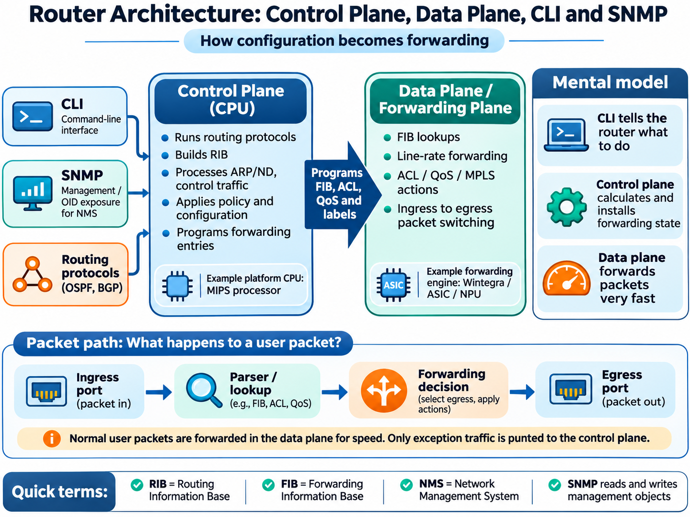

A router separates *deciding how to forward* from *forwarding packets*. The **control plane** runs routing protocols such as OSPF/BGP, builds the Routing Information Base (RIB), and programs forwarding state. The **data plane** uses the Forwarding Information Base (FIB), ACL and QoS rules to forward normal packets at high speed.

## MIPS and Wintegra example

In an embedded router design, a MIPS CPU can host Linux, routing daemons, CLI and management agents. A Wintegra network processor can implement the high-speed forwarding path. The exact responsibilities depend on the hardware and firmware design: not every router uses these chips.

```text
Operator / NMS
    | CLI / SNMP / configuration
    v
Control-plane software on MIPS CPU
    | routing protocols -> RIB -> FIB / policy programming
    v
Driver / SDK / hardware abstraction layer
    | install forwarding entries, ACLs, QoS rules
    v
Wintegra forwarding engine
    | ingress packet -> lookup -> action -> egress packet
```

The CLI (*Command-Line Interface*) parses administrator commands and invokes configuration/operational software. SNMP (*Simple Network Management Protocol*) exposes managed objects identified by OIDs described by MIBs; an SNMP agent responds to NMS queries and may permit authorised SET operations. SNMPv3 is preferred for authentication and privacy. The management plane is often described separately from the control plane, even when they share the same CPU.

## What does programming the data plane mean?

The control plane computes or receives routes, resolves next hops, converts selected routing state into forwarding entries, and installs them through a driver or SDK. Most packets then stay in the forwarding engine. Exceptions (for example, some control packets or unresolved next hops) may be punted to the CPU. The precise punt behaviour is platform-specific.
