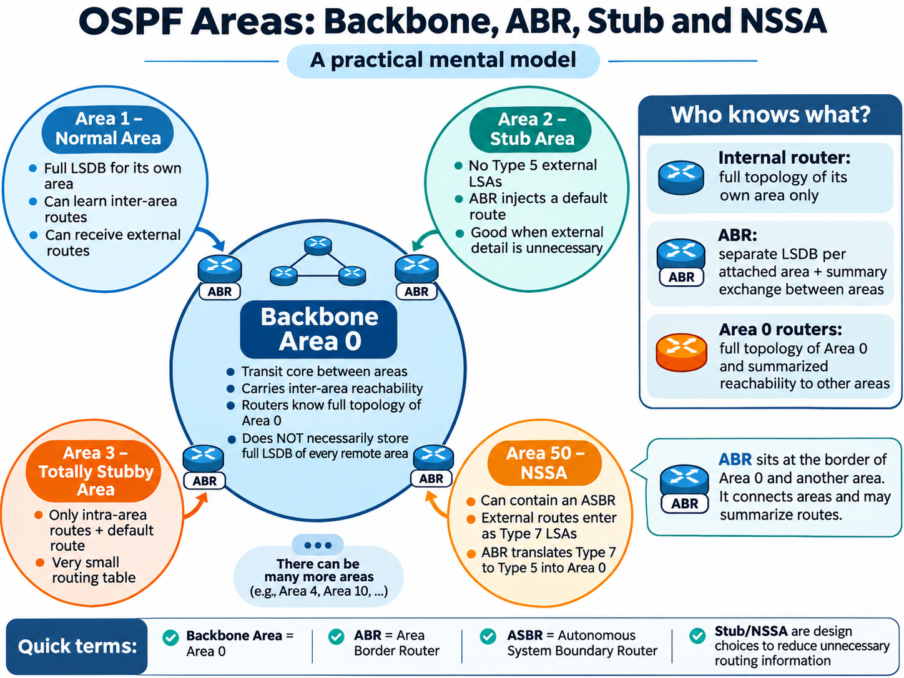

# OSPF Areas: Backbone, ABR, Stub and NSSA

OSPF divides one routing domain into areas to reduce flooding and SPF calculation scope. **Area 0** is the backbone through which normal inter-area traffic and route advertisements transit. **ABR** means *Area Border Router*: it belongs to multiple OSPF areas and maintains a separate link-state database (LSDB) for each attached area.

## Does Area 0 know every router?

No. An internal router has a detailed LSDB for its own area, not the detailed topology of all other areas. An Area 0 internal router has the Area 0 LSDB and receives inter-area reachability via ABR-generated Type 3 summary LSAs; it does not automatically know every router-to-router link inside Area 1 or Area 50. An ABR maintains the detailed LSDB of every area it participates in. Route summarisation is optional at ABRs and can reduce route detail further.

## What is a stub area?

A **stub area** does not flood Type 5 external LSAs; its ABR normally injects a default route so internal routers can reach external destinations. A **totally stubby area** (vendor extension) also suppresses most inter-area summaries, leaving intra-area routes and a default route. An **NSSA** permits an ASBR to inject external routes as Type 7 LSAs, which an NSSA ABR can translate to Type 5 outside the NSSA. A *totally NSSA* combines NSSA behaviour with stronger inter-area suppression (implementation-specific).

## Important boundaries

An ABR is not automatically the default gateway for every device. It is the OSPF router joining areas. Area IDs such as 1, 2, and 50 are identifiers, not a count of physical routers. OSPF area design is constrained by topology and scale, not a fixed rule that the backbone can connect to only 50 areas.

## Mental model

Think of Area 0 as the inter-area transit backbone, not a universal database containing all internal topology. Internal routers know their own area's topology; ABRs connect areas and advertise reachability.
