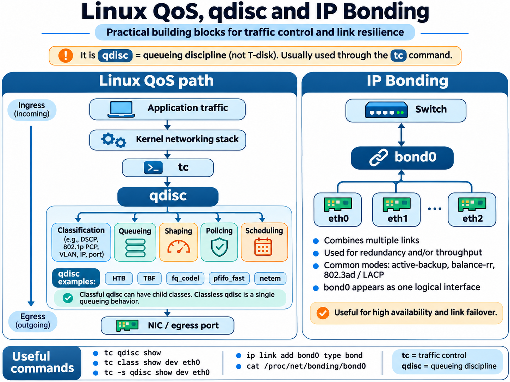

The term is **qdisc**, short for *queueing discipline*, not T-disk. The Linux `tc` (*traffic control*) command configures queueing, scheduling, shaping and filtering. The diagram is a conceptual overview: `tc` is a configuration utility, not a per-packet processing stage. Packets traverse kernel networking and the configured qdisc on the relevant path.

## QoS building blocks

- **Classification** selects traffic based on fields such as DSCP, IP address, port or VLAN priority.
- **Queueing/scheduling** determines which packets are transmitted first.
- **Shaping** delays packets to enforce an output rate; **policing** drops or remarks traffic exceeding policy.
- Common qdiscs include HTB (hierarchical shaping), TBF (token bucket), `fq_codel` (flow queueing/active queue management), and `netem` (network impairment simulation). `pfifo_fast` is a historical default on some systems, not a universal current default.

```bash
tc qdisc show
tc -s qdisc show dev eth0
tc class show dev eth0
```

## IP bonding

Linux bonding creates a logical interface, commonly `bond0`, from physical links such as `eth0` and `eth1`. `active-backup` provides failover; `802.3ad` uses LACP when the switch is correctly configured; other modes offer different balancing semantics. A single flow generally does not gain the sum of all link speeds under LACP hashing.

```bash
ip link add bond0 type bond
cat /proc/net/bonding/bond0
```

The `ip link add` command only creates the logical bond; slaves, mode, IP configuration and switch-side settings must still be configured. On modern Linux, NetworkManager or systemd-networkd is often used to persist bonding configuration.
