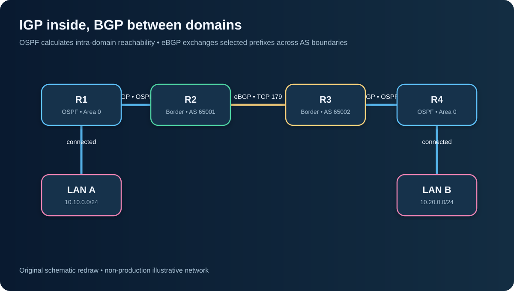
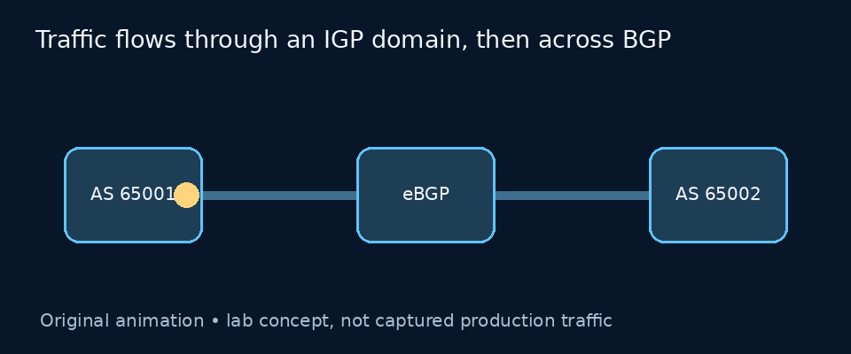
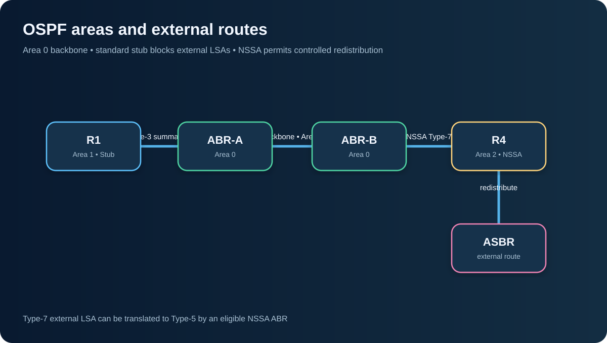
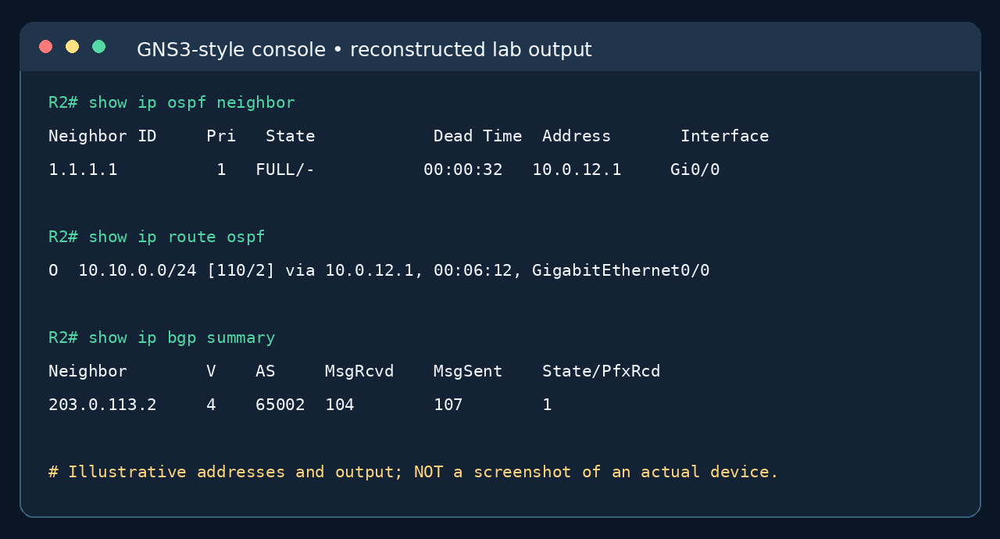

> **From my engineering notebooks (2018–2019), reconstructed for publication in November 2026.** The original themes appear in my FreeMind notes and networking experiments. The topology, configuration and terminal image below are **new, educational reconstructions**, not company diagrams, production data or captures of a real GNS3 session.

## First, what problem are we solving?

When I started thinking about telecom networks, a simple question helped me: **How does one router learn a network it is not directly connected to?** And when that network belongs to a completely different service provider, **who tells it which path to take?**

I divide the answer into two layers:

- **Inside one administrative network:** use an **Interior Gateway Protocol (IGP)** such as OSPF or IS-IS to compute reachability and react to topology changes.
- **Between autonomous systems:** use **Border Gateway Protocol (BGP)** to exchange selected IP prefixes and apply routing policy. In practice, BGP can also run internally (iBGP) to distribute those external routes inside the AS.





In my historical mind map, I wrote essentially: *IGP — OSPF; EGP — BGP; telecom players have AS numbers; BGP runs between AS numbers.* That was a useful starting map, but the real design is richer than just two acronyms.

## OSPF: routers learning the internal map

OSPF stands for **Open Shortest Path First**. It is a link-state protocol. Routers exchange link-state information, maintain an area-specific link-state database and run shortest-path calculations. The **cost** of a link influences the selected path. The goal is not automatically “the least number of hops”; it is the least *total OSPF cost*.

A good mental model is that each router gets a consistent map of its area and independently calculates where to send packets. **OSPF is a control-plane protocol**; the router still forwards packets using its installed forwarding table.

### Backbone, stub areas and NSSA



| Area | What I should remember | Practical reason |
|---|---|---|
| **Area 0** | Backbone area connecting other OSPF areas via ABRs | Hierarchical routing design |
| **Normal area** | Allows the normal classes of LSAs, including external-route information | Flexible, but more LSA information |
| **Stub area** | Blocks Type-5 external LSAs; typically receives a default route | Reduce external route detail |
| **Totally stubby area** | Cisco extension that also suppresses most inter-area summaries | Very small routing table in a leaf area |
| **NSSA** | **Not-So-Stubby Area** permits an ASBR to inject external routes as Type-7 LSAs | Redistribution from a remote branch while retaining stub-like properties |

An NSSA ABR can translate eligible Type-7 LSAs to Type-5 LSAs for the wider OSPF domain. **NSSA is not simply another name for a stub area.** In a conventional stub area, redistributing a new external route inside that area is not allowed.

A commonly useful command family on Cisco IOS:

```text
show ip ospf neighbor
show ip ospf interface brief
show ip ospf database
show ip ospf database external
show ip route ospf
show ip protocols
```

What am I looking for? **Neighbour state**, correct area membership, exchanged LSAs, installed OSPF routes and the next hop. `FULL` adjacency is normally the desired outcome on a point-to-point link; on broadcast networks, `2-WAY` between two DROTHER routers can be normal.

### A small GNS3 backbone lab

Use two routers with point-to-point link `10.0.12.0/30`, and a LAN on R1. Exact interface names depend on the Cisco IOS image you are licensed to run in GNS3.

**R1:**

```cisco
configure terminal
hostname R1
interface GigabitEthernet0/0
 ip address 10.0.12.1 255.255.255.252
 no shutdown
interface GigabitEthernet0/1
 ip address 10.10.0.1 255.255.255.0
 no shutdown
router ospf 10
 router-id 1.1.1.1
 network 10.0.12.0 0.0.0.3 area 0
 network 10.10.0.0 0.0.0.255 area 0
end
show ip ospf neighbor
show ip route ospf
```

**R2:**

```cisco
configure terminal
hostname R2
interface GigabitEthernet0/0
 ip address 10.0.12.2 255.255.255.252
 no shutdown
router ospf 10
 router-id 2.2.2.2
 network 10.0.12.0 0.0.0.3 area 0
end
show ip ospf neighbor
show ip route ospf
```

The loop is straightforward: bring up interfaces, form an adjacency, examine the OSPF route on R2 to `10.10.0.0/24`, then shut one link and observe the behaviour. If the test topology has only one path, traffic cannot magically continue—the point is to distinguish *route withdrawal and reconvergence* from *real redundancy*.



## BGP: networks connect through autonomous systems

An **Autonomous System (AS)** is a routing-policy domain with an ASN (Autonomous System Number). In a simplified ISP diagram, Telstra, Optus and Aussie Broadband connect with other networks through BGP. BGP is a **path-vector** protocol: it exchanges reachable **prefixes** and path attributes such as `AS_PATH`, `NEXT_HOP` and `LOCAL_PREF`. It does not perform OSPF's topology flooding across the Internet.

- **eBGP** exchanges routes between different ASNs.
- **iBGP** exchanges BGP routes within the same AS.
- **OSPF** can provide internal loopback/next-hop reachability needed by BGP without itself carrying the entire Internet routing table.

### How do I find a provider's ASN?

Look up an organisation or a public IP prefix in an **RIR registry** such as APNIC or an observed-routing service such as [bgp.tools](https://bgp.tools/), [Hurricane Electric BGP Toolkit](https://bgp.he.net/) or [RIPEstat](https://stat.ripe.net/). Then check **which ASN originates the actual prefix**, not only who sells the mobile plan.

| Example | Useful public ASN to investigate | Qualification |
|---|---:|---|
| Telstra | **AS1221** | Telstra operates multiple ASNs; this is a prominent example |
| Optus | **AS7474**; also investigate **AS4804** | Different Optus network segments can have different ASNs |
| Aussie Broadband | **AS4764** | Commonly associated with the ABB network |
| Woolworths / Everyday Mobile | **Not simply one mobile-provider ASN** | Everyday Mobile uses the **Telstra Wholesale Mobile Network**; Woolworths Group's separate AS153814 does **not** identify all mobile subscribers' internet paths |

ASN ownership and prefix advertisements can change; check current routing data before making a claim about a specific IP address. A brand, an MNO, a reseller and an Internet transit AS are not interchangeable concepts.

**Two practical lookups:**

```bash
whois -h whois.apnic.net AS1221
whois -h whois.apnic.net AS7474
```

For a specific address, a public BGP lookup is more informative than assuming every IP address used by an ISP originates from one AS.

### Small eBGP example: two private ASNs

These are **lab-only private ASNs** (`65001` and `65002`) and documentation addresses. Assume Router R2 has a route to `10.10.0.0/24` in its routing table, while R3 has a route to `10.20.0.0/24`.

**R2 — AS 65001:**

```cisco
interface GigabitEthernet0/1
 ip address 203.0.113.1 255.255.255.252
 no shutdown
router bgp 65001
 bgp router-id 2.2.2.2
 neighbor 203.0.113.2 remote-as 65002
 neighbor 203.0.113.2 description LAB-AS65002
 network 10.10.0.0 mask 255.255.255.0
```

**R3 — AS 65002:**

```cisco
interface GigabitEthernet0/1
 ip address 203.0.113.2 255.255.255.252
 no shutdown
router bgp 65002
 bgp router-id 3.3.3.3
 neighbor 203.0.113.1 remote-as 65001
 neighbor 203.0.113.1 description LAB-AS65001
 network 10.20.0.0 mask 255.255.255.0
```

The BGP `network` command advertises an **exact matching route already present in the local RIB**; it does not create a route to that prefix. Also configure the internal paths and return routes appropriately for end-to-end reachability.

Verify:

```text
show ip bgp summary
show ip bgp
show ip route bgp
show ip bgp neighbors
```

### Can OSPF routes be redistributed into BGP—and back again?

Yes, with **explicit design and filtering**. For example, a BGP router may advertise selected OSPF-learned customer prefixes with `network` statements or `redistribute ospf` governed by route maps/prefix lists. But **do not redistribute everything both ways**: route feedback, accidental transit, excessive routing state and security exposure are real risks. A default route into an internal area is often a simpler design than injecting a full external table.

```cisco
! Illustrative boundary policy: permit only one internal prefix
ip prefix-list EXPORT-LAN seq 5 permit 10.10.0.0/24
route-map OSPF-TO-BGP permit 10
 match ip address prefix-list EXPORT-LAN
router bgp 65001
 redistribute ospf 10 route-map OSPF-TO-BGP
```

This is an example of policy structure, **not** a configuration to apply to an Internet-facing device without route-leak safeguards and verification.

### BGP neighbour TCP-MD5 authentication

One historical engineering note of mine says: *BGP peer authentication — MD5 sum — socket option — kernel — double pointer versus pointer.* I remember it as a reminder that a routing failure can cross layers: BGP configuration, TCP socket behaviour, C pointer handling and kernel APIs. It does **not** by itself prove the exact code fix or author.

In a compatible Cisco training lab, a neighbour password can configure TCP-MD5 authentication:

```cisco
router bgp 65001
 neighbor 203.0.113.2 password lab-shared-secret
```

Configure a matching password on the peer. Use protected secret handling in real deployments. TCP-MD5 is a legacy mechanism with limitations; evaluate TCP-AO and platform-supported protections where appropriate.

## The mental model I keep

**OSPF tells routers how to reach things within their own domain. BGP tells different routing-policy domains which prefixes they are willing to exchange.** A healthy provider network needs both *fast and correct internal convergence* and *carefully controlled external reachability*. Fast does not mean uncontrolled, and an AS path is not the same as a measured latency path.

**Shreyas Joshi**  
*CCNA certified — Routing and Switching*

**Technical references:** [OSPF NSSA RFC 3101](https://www.rfc-editor.org/rfc/rfc3101) · [BGP RFC 4271](https://www.rfc-editor.org/rfc/rfc4271) · [Telstra AS1221](https://bgp.tools/as/1221) · [Optus AS7474](https://bgp.tools/as/7474) · [Aussie Broadband AS4764](https://bgp.tools/as/4764) · [Everyday Mobile coverage](https://mobile.everyday.com.au/coverage)
