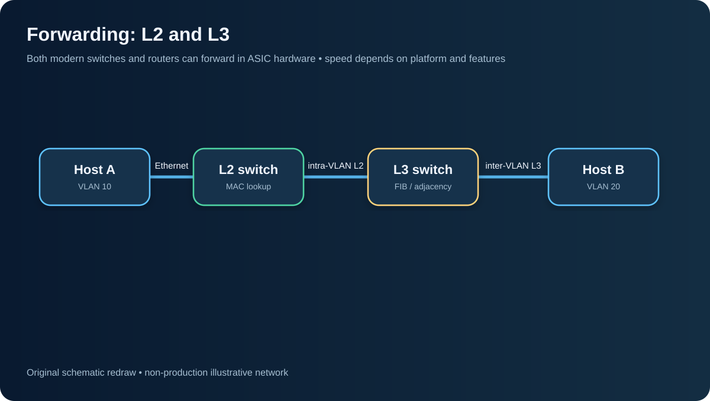
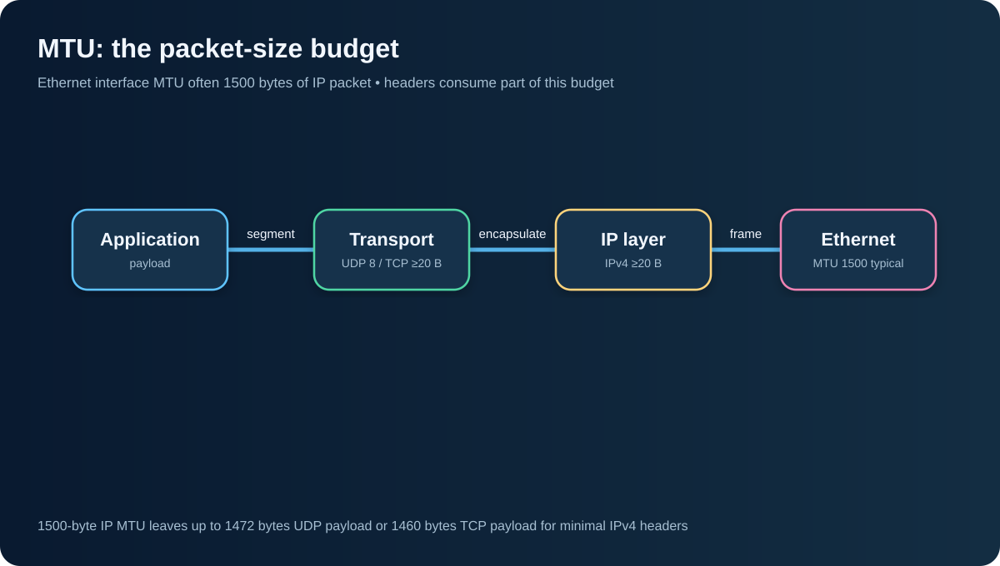

> **Historical engineering topic, rewritten November 2026.** Diagrams and examples are original illustrations; they do not show proprietary equipment.

## I used to ask: why is switching faster than routing?

My early mental model was straightforward: *Layer 2 reads the destination MAC address and sends the frame; Layer 3 must read the IP destination and work out the next hop, so routing takes longer.* That is useful for understanding the **different forwarding decisions**, but it is not universally true of real hardware.



**At Layer 2**, a bridge or switch looks up a destination MAC within its forwarding database (often VLAN-specific). **At Layer 3**, a router or L3 switch looks up a destination IP prefix in the forwarding information base, selects an adjacency and rewrites the Ethernet header for the outgoing link. A router also processes IP hop-limit/TTL rules.

The important correction: **modern Layer 3 switches can route at wire speed with ASICs**. Sometimes L3 forwarding has negligible incremental latency compared with L2; performance depends on silicon, features, packet size, queues, encapsulation and whether traffic is hardware-forwarded or punted to CPU. A simple L2-vs-L3 label cannot establish which device is faster.

## Ethernet, MTU and the packet-size budget

**MTU = Maximum Transmission Unit.** It is **not simply a Layer 1 feature**. MTU is a size limit associated with an interface/link-layer service; for IP over ordinary Ethernet, a common IP MTU is **1500 bytes**. Physical-layer transmission contributes the wire encoding and overhead, but the familiar 1500-byte MTU is a network-interface / IP packet limit rather than a property such as voltage or frequency.



For a standard IPv4 packet with no IP or transport options:

| Item | Bytes |
|---|---:|
| Ethernet IP MTU | 1500 |
| IPv4 header | 20 |
| UDP header | **8** |
| TCP minimum header | **20** |
| Max UDP application payload (IPv4, MTU 1500) | **1472** |
| Max TCP payload per segment (IPv4, MTU 1500, no options) | **1460** |

UDP does **not** have a seven-byte header, and TCP does **not** have a fixed 21-byte header. TCP is at least 20 bytes and often more because options such as timestamps increase header length. Ethernet's frame header/FCS, preamble, inter-frame gap and VLAN tags involve additional *on-wire* overhead that is not all counted the same way in a 1500-byte IP MTU.

### Would smaller packets make my voice/video faster?

Smaller packets can reduce **packetization delay** and blocking time on a slow link, and may lower the impact of one lost packet. But they increase per-packet header overhead and the number of packets routers/NICs process. A 20 ms audio packet may feel more responsive than a 100 ms audio packet, at the cost of a higher packets-per-second rate. The best value depends on codec, network and jitter buffer.

### And what about bigger packets?

Larger packets can improve bulk-transfer efficiency by amortising headers and reducing packet rate. **Jumbo frames** can be useful inside a controlled network where *every relevant hop* supports them. They are not automatically suitable across the public Internet or tunnels. Encapsulation such as MPLS, GRE, VLANs or IPsec can also consume additional path MTU budget.

**What if a packet exceeds the next-hop MTU?** With IPv4, a router may fragment an oversized packet if fragmentation is permitted, but with DF set it normally discards the packet and sends an ICMP Fragmentation Needed message. IPv6 routers do not fragment transit packets; the sender must adapt. Reassembly is normally done at the destination IP endpoint, not at every intermediate router. Modern designs generally prefer **Path MTU Discovery** and adjusting segment sizes, rather than relying on in-path fragmentation.

### TCP and UDP are a trade-off, not a speed contest

**TCP:** byte-stream transport with acknowledgements, ordered delivery to the application, retransmissions, flow control and congestion control. This suits many web, file and transaction workflows, although the application must still handle timeouts and its own correctness.

**UDP:** datagram transport with small fixed header and no built-in ordered reliable delivery. This suits interactive voice/video and many real-time protocols because applications can decide which late packets are no longer useful. **UDP itself does not guarantee low latency, quality, reliability or congestion fairness.** Real-time applications may add jitter buffers, forward error correction or selective loss recovery. Also note: **QUIC runs on UDP but adds reliable streams and congestion control**, so “UDP is always unreliable at application level” is misleading.

For voice, a packet arriving after the playback moment may be nearly as unhelpful as a lost packet. For a financial transaction, losing or reordering application data may be unacceptable. Different requirement; different transport/application design.

## My practical Linux lab

```bash
# Inspect interface MTU
ip link show eth0

# Set a temporary MTU on a disposable Linux lab interface
sudo ip link set dev eth0 mtu 1400

# Test IPv4 Path MTU with DF: -s is ICMP payload, not entire IP packet
ping -M do -s 1372 192.0.2.1

# Observe UDP/TCP and possible ICMP MTU errors on a lab interface
sudo tcpdump -ni eth0 'tcp or udp or icmp'
```

For the ping example, 1372 bytes of ICMP payload plus 8 ICMP and 20 IPv4 header bytes equals a 1400-byte IP packet. Behaviour depends on network/firewalls, and the example address is documentation-only.

## What I learnt

When I hear *“switching is faster”*, my next questions are: **Which hardware? Which features? What packet sizes? What link rate? Is traffic in ASIC or CPU?** The bottleneck might be serialization, queueing, a tunnel's reduced MTU, fragmentation or application behaviour—not the OSI layer number.

**Shreyas Joshi**  
*CCNA Routing and Switching — previously earned (December 2018); expired December 2021*

**References:** [UDP RFC 768](https://www.rfc-editor.org/rfc/rfc768) · [TCP RFC 9293](https://www.rfc-editor.org/rfc/rfc9293) · [Path MTU Discovery RFC 1191](https://www.rfc-editor.org/rfc/rfc1191) · [IPv6 RFC 8200](https://www.rfc-editor.org/rfc/rfc8200)
