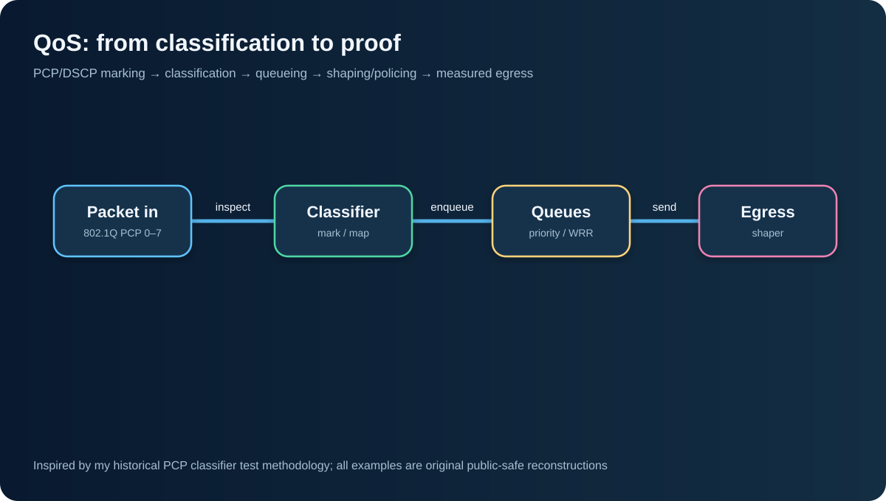

> **Source provenance:** This article is a public-safe reconstruction informed by my historical Python network test scripts. Code below is newly written for education and is not a snapshot of the original test suite.

## QoS starts when a link is congested

If every packet arrives at the same time, who gets to go first? That is the real reason to talk about **Quality of Service (QoS)**. QoS does **not create extra bandwidth**. It gives us tools to manage *how competing traffic uses a constrained network*.



I separate the vocabulary into verbs:

1. **Classify:** identify which traffic belongs to which class.
2. **Mark:** assign or rewrite a priority indication (802.1Q PCP, IP DSCP).
3. **Queue/schedule:** decide the order in which packets leave.
4. **Shape:** buffer and pace egress to a target rate (introducing delay if necessary).
5. **Police:** enforce a traffic rate, often dropping or re-marking excess packets.
6. **Measure:** compare transmitted and received packets/bytes, delay, loss and class behaviour.

### Layer 2 PCP is not the same as Layer 3 DSCP

802.1Q **PCP (Priority Code Point)** is a three-bit VLAN tag priority field with values **0–7**. **DSCP** is a six-bit IP header field. Devices can map between them according to policy, but they are not automatically one-to-one or end-to-end trusted. **Priority 7 is numerically highest but does not guarantee a real queue receives special treatment** unless the device is configured accordingly.

### A concrete test I recognised in my old work

The historical classifier test used a **single device**, two traffic-tester ports, VLAN-tagged frames, multiple **PCP 0–7 traffic streams**, and checks against transmitted/received byte counters. It exercised a **straight priority map** and then an **inverted priority map**. It also varied offered traffic rates under an output shaping policy and checked which streams were preserved. These details are from reviewing my own test file, not from a general networking tutorial.

That testing style asks better questions than “is QoS enabled?”

- Under low offered load, do all classes pass?
- When all classes compete, which streams lose throughput first?
- Does changing the PCP-to-queue mapping change observed results?
- Does measured packet loss match the configured policy and the tester's counters?

## New Python teaching model: priority scheduling

This short standalone simulation models three traffic classes competing for an **80 Mbps** bottleneck. It is deliberately not an imitation of any proprietary device SDK.

```python
# self-contained teaching model, not a hardware benchmark

def strict_priority(offers_mbps: dict[str, float], limit_mbps: float):
    """Allocate capacity from highest to lowest configured priority."""
    left = limit_mbps
    delivered = {}
    for traffic_class in ("voice", "video", "bulk"):
        delivered[traffic_class] = min(offers_mbps[traffic_class], left)
        left -= delivered[traffic_class]
    return delivered

requested = {"voice": 10, "video": 40, "bulk": 60}
actual = strict_priority(requested, limit_mbps=80)
print(actual)
# {'voice': 10, 'video': 40, 'bulk': 30}
assert sum(actual.values()) == 80
```

That gives us the *idea* of priority scheduling. It ignores bursts, packet sizes, token buckets, queue depths, weighted scheduling, preemption, microbursts and actual implementation behaviour. Real engineering needs **traffic generation and measured counters**, not just a Python model.

The full, newly written public exercise is in [`public-labs/qos_model.py`](/public-labs/qos_model.py) in the downloadable package.

## A small Cisco QoS inspection checklist

```text
show interfaces
show interfaces counters errors
show policy-map interface
show class-map
show policy-map
```

Commands and supported configuration syntax depend on the image and platform. Some GNS3 IOS appliances do not support the same hardware QoS features as a physical switch or carrier Ethernet platform. Use the simulator for **protocol reasoning and configuration concepts**, then validate hardware QoS with real devices or capable test equipment.

## What I would test next

For voice/video, the most useful outputs are not just “the packet went through.” They are **loss, one-way delay where clocks are synchronised, jitter, packetization interval, queue depth and observed bitrate**. A strict priority queue that starves all other traffic is not a successful enterprise design. Policing, bandwidth guarantees and correctly bounded queues matter.

## My practical takeaway

QoS is the behaviour of a network **under contention**. My testing question became: *I marked the packets; did the forwarding behaviour actually change when the network became busy?* The difference between configuration and evidence is where test automation adds value.

**Shreyas Joshi**  
*CCNA certified — Routing and Switching*

**References:** [IEEE 802.1Q background](https://www.ieee802.org/1/pages/802.1Q.html) · [DiffServ architecture RFC 2475](https://www.rfc-editor.org/rfc/rfc2475)
