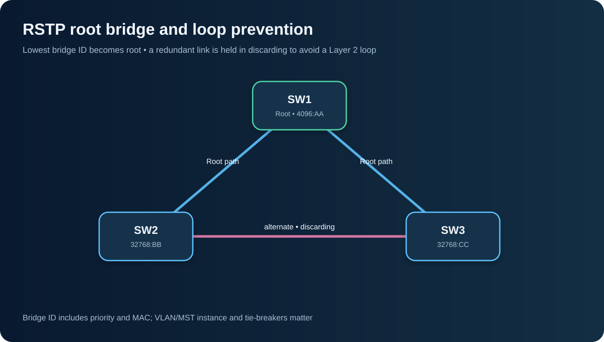
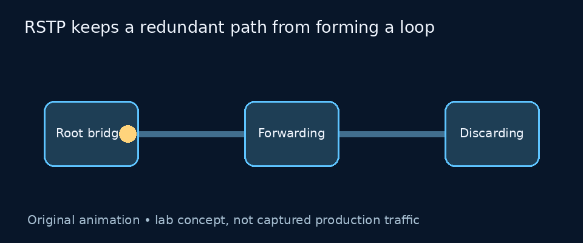

> **Historical lab reconstruction, prepared November 2026.** My private Python `test_rstp.py` includes tests for root election, loop prevention, link-break convergence and path-cost changes. Its employer-specific test code is **not** reproduced; the Python below is a fresh independent teaching example.

## Why do we need Spanning Tree at all?

Redundancy is good until **Ethernet frames keep circulating around a loop**. A switch can flood unknown-unicast, broadcast and certain multicast traffic. With a Layer 2 loop and no effective loop prevention, frames can multiply and circle because ordinary Ethernet bridging has no IP-style TTL. The result is a **broadcast storm**, MAC-address flapping, congestion and potentially severe switch CPU/load issues.

The accurate statement is not “a router always crashes when there is a loop.” The immediate danger is a **Layer 2 broadcast domain** and its switches/bridges. A router connected to it may also be affected by excessive traffic, but it is not an inevitable router crash.





## Electing a root bridge

The **Bridge ID** contains a bridge priority component (with an extended system ID for VLAN/instance where applicable) and a MAC-address component. Bridges elect the **lowest bridge ID**. A switch then picks a best route *towards the root* using path cost and tie-breakers; this influences root, designated and alternate/discarding port roles.

Imagine three switches:

| Switch | Effective bridge priority | MAC (illustrative) | Expected result |
|---|---:|---|---|
| SW1 | 4096 | 00:00:00:00:00:AA | Root |
| SW2 | 32768 | 00:00:00:00:00:BB | Non-root |
| SW3 | 32768 | 00:00:00:00:00:CC | Non-root |

SW1 wins because its priority component is lower. If priority ties, the MAC portion helps decide. An alternate port blocks a redundant forwarding path, but RSTP can activate a suitable path after a change.

### What my historical Python test checked

The original `test_rstp.py` described a sensible automated validation sequence: retrieve each node's Bridge ID, check IDs are unique, **sort to find the expected lowest Bridge ID**, poll all devices until they agree on the root, and verify port roles. Separate tests generated traffic through a potentially looped topology, inspected interface counters, and examined convergence after **breaking a link** or **changing path cost**.

This is a stronger test than simply checking that STP is enabled. It validates **election, convergence and actual traffic behaviour**.

Here is new public-safe code showing the root-election expectation, without copying the device libraries:

```python
# Standalone model: the expected winner, not a full STP implementation.
bridges = [
    ("SW1", 4096, "00:00:00:00:00:aa"),
    ("SW2", 32768, "00:00:00:00:00:bb"),
    ("SW3", 32768, "00:00:00:00:00:cc"),
]

# For a single agreed VLAN/instance, compare priority then MAC.
root = min(bridges, key=lambda b: (b[1], int(b[2].replace(':', ''), 16)))
print("Expected root:", root[0])  # SW1
```

The longer independent script [`public-labs/root_election_demo.py`](/public-labs/root_election_demo.py) also checks simulated device reports. **Real RSTP chooses port roles using more information than this small comparison.**

## My GNS3/Cisco validation commands

```text
show spanning-tree
show spanning-tree vlan 10
show spanning-tree detail
show interfaces status
show mac address-table dynamic
```

On a Cisco lab switch supporting Rapid PVST+, this training configuration can deliberately bias a VLAN's root choice:

```cisco
configure terminal
spanning-tree mode rapid-pvst
spanning-tree vlan 10 priority 4096
end
show spanning-tree vlan 10
```

Not all GNS3 switch emulators implement hardware STP/RSTP features accurately. IOSvL2 or other licensed virtual switching images are usually preferable to GNS3's most basic Ethernet switch node for this experiment.

### Three experiments I would run

1. **Baseline:** bring up all triangle links; capture the root bridge and forwarding/discarding roles. Check reachability.
2. **Link failure:** disable one active link, time from physical change to stable forwarding and recovered traffic. Compare observed packet loss with expected behaviour.
3. **Path-cost change:** adjust the relevant STP cost in the lab and observe whether the alternate choice changes while the root remains consistent.

Use `tcpdump`/Wireshark BPDU captures and traffic counters where possible. Avoid connecting an uncontrolled Ethernet loop to any real shared network.

## The mental model I retain

The root bridge is **not a master device that forwards every frame**; it is the reference point used to build a loop-free logical tree. RSTP gives redundancy without leaving every redundant path forwarding at once. The point of automation is to prove that all devices **agree**, not just to read one configuration command.

**Shreyas Joshi**  
*CCNA certified — Routing and Switching*

**References:** [RSTP overview (IEEE 802.1D background)](https://www.ieee802.org/1/pages/802.1D.html) · [Cisco spanning tree technology](https://www.cisco.com/c/en/us/tech/lan-switching/spanning-tree-protocol/index.html)
