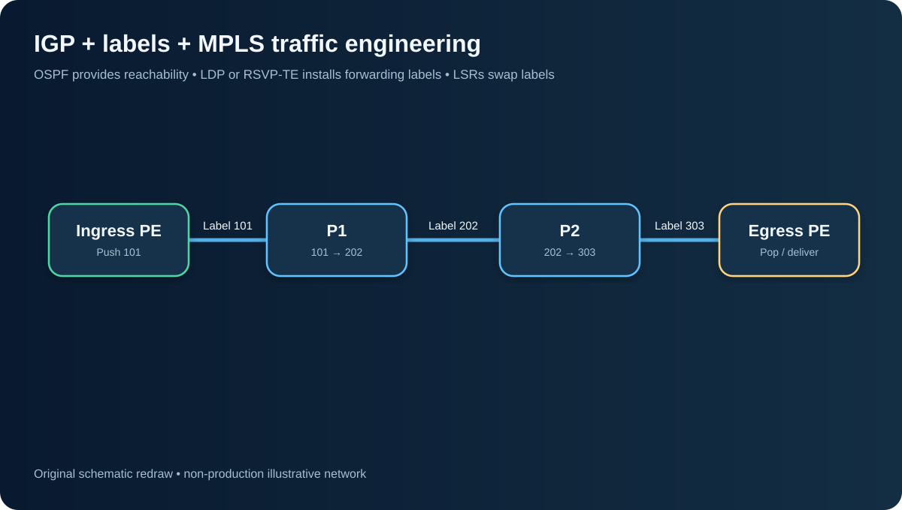
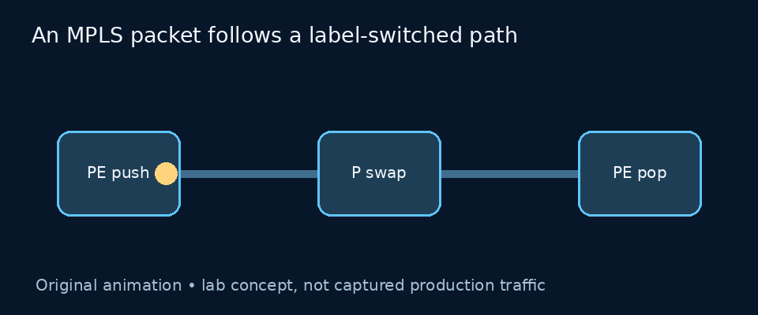

> **Source note:** My personal Linux/MPLS notebook recorded Quagga-LDPD links, Linux MPLS forwarding, `tcpdump` and historical kernel experiments. This article reconstructs the mental model; all diagrams are newly drawn. It does not reproduce private training decks or employer network topology.

## My question: OSPF already knows the route—why MPLS?

OSPF can compute the next hop to an IP destination, but a service-provider backbone may need **service separation, label-switched forwarding and constrained paths**. That is why I mentally separate three jobs:

- **IGP (OSPF or IS-IS):** reach the other routers and their loopbacks inside the provider network.
- **Label distribution / tunnel setup:** use mechanisms such as **LDP** or **RSVP-TE**, depending on design, to establish usable label forwarding entries or engineered LSPs.
- **Data plane:** forwards packets with labels by **push**, **swap** or **pop** actions. Labels are locally significant between neighbours, not permanent global destination identifiers.





An ingress provider-edge router may push a label, intermediate label-switching routers swap transport labels, and the penultimate hop may perform penultimate-hop popping (PHP) where supported/appropriate. Real L3VPN and other services may use **a stack of labels**, not just one. One label may steer through the transport LSP; another can identify the VPN forwarding context.

### A common misunderstanding

“OSPF creates the MPLS labels” is **not quite right**. OSPF advertises IP reachability (and, with TE extensions, additional link attributes). **LDP or RSVP-TE** typically distributes or signals labels in traditional MPLS designs; additional modern MPLS mechanisms exist. The IGP and label-control plane cooperate, but each has a distinct responsibility.

## What is OSPF-TE?

**OSPF Traffic Engineering extensions** (RFC 3630) advertise attributes relevant to path calculation, such as TE metrics, available/reservable bandwidth and administrative groups where supported. OSPF-TE primarily **adds information to the topology database**. It does not by itself reserve bandwidth or create an RSVP-TE tunnel.

**RSVP-TE** (RFC 3209) can signal explicitly routed label-switched paths and request resource reservations. An ingress router or path-computation system can consider policy constraints such as bandwidth or link attributes. This can deliberately choose a path that is **not the normal lowest-IGP-cost route**.

| Topic | OSPF / OSPF-TE | MPLS / RSVP-TE |
|---|---|---|
| Primary job | Discover reachability; optionally publish TE attributes | Forward by label; optionally signal explicit/reserved paths |
| Control-plane data | Link-state database | Labels, LSP/tunnel state, reservation signalling |
| Normal objective | Shortest path under IGP cost | Service forwarding / constraints / path policy |
| Typical risk | Adjacency instability, flooding, cost mistakes | Label mismatch, tunnel failure, poor reservation or path choice |

**Caution:** bandwidth advertised for TE is not the same thing as real measured end-user throughput; TE does not guarantee an application's SLA without the complete network design.

## A historical Linux/MPLS notebook experiment

My old notes included this exact kind of capture:

```bash
sudo tcpdump -n -i eth2 'mpls and icmp'
```

The intention was to observe **MPLS-encapsulated ICMP traffic**, not merely ping a destination and assume labels were active. Historical notes also pointed to a Quagga LDP daemon and Linux MPLS forwarding support, including explicit-null label behaviour and Linux kernel/IPRoute2 compatibility questions.

A modern Linux/FRR lab can inspect the MPLS-related state using commands available in its installed build, for example:

```bash
# Linux routes/labels where MPLS support is enabled
ip -f mpls route show

# FRR interactive CLI: exact command support is version dependent
sudo vtysh -c 'show ip route'
sudo vtysh -c 'show mpls ldp neighbor'
```

**Do not paste historical kernel-specific commands into a production host.** MPLS kernel modules, sysctls, `iproute2`, FRR build features and distro versions determine which examples work.

## A useful five-step lab in GNS3

1. Draw **PE1–P1–P2–PE2**. Give routers point-to-point links and /32 loopbacks.
2. Configure OSPF Area 0 across the core. Confirm all intended loopbacks are reachable before involving labels.
3. Enable MPLS transport/LDP on supported virtual-router images. Confirm neighbour sessions and forwarding labels.
4. Generate ping and traceroute traffic from one edge to the other; inspect the MPLS table and packet captures.
5. Only then explore **RSVP-TE** and explicit paths on a platform/image that supports them. Compare the plain IGP path with the engineered LSP.

**Verify, don't assume:**

```text
show ip ospf neighbor
show ip route
show mpls forwarding-table
show mpls ldp neighbor
show mpls traffic-eng tunnels
```

These are Cisco-style verification examples; the available subset varies by IOS family, licence and feature set. An ordinary virtual IOS image may lack MPLS TE.

## What I learnt

The simplest memory aid is **map → labels → forwarding**. OSPF makes the underlay reachable; label signalling establishes the forwarding context; MPLS moves packets across the backbone according to those labels. OSPF-TE enriches the map; RSVP-TE can use that information to build a deliberately constrained LSP.

**Shreyas Joshi**  
*CCNA certified — Routing and Switching*

**References:** [MPLS Architecture RFC 3031](https://www.rfc-editor.org/rfc/rfc3031) · [OSPF-TE RFC 3630](https://www.rfc-editor.org/rfc/rfc3630) · [RSVP-TE RFC 3209](https://www.rfc-editor.org/rfc/rfc3209) · [FRRouting](https://docs.frrouting.org/en/latest/)
