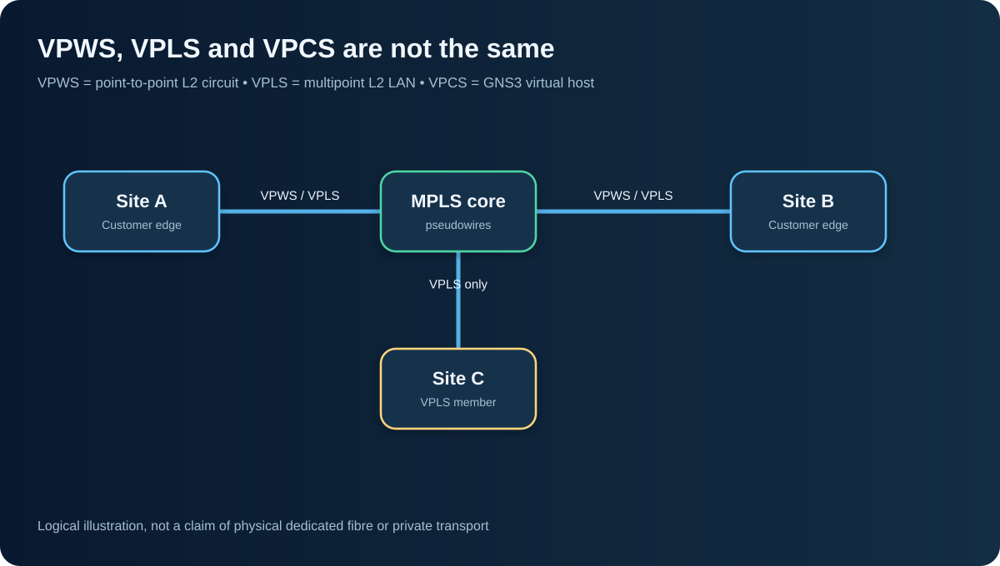

> **Lab-study reconstruction (updated November 2026).** I have not verified an original VPLS/VPWS lab file in my private notes, so the design below is an independent learning explanation inspired by my broader MPLS/GNS3 work—not a claim that I deployed this service at an employer.

## Three similar names, three different jobs

I kept mixing up **VPWS, VPLS and VPCS**. The easiest way to separate them is to ask: **Are we emulating a customer Ethernet service, or just creating a test PC?**



| Term | What it is | How I picture it |
|---|---|---|
| **VPWS** (Virtual Private Wire Service) | Point-to-point Layer 2 service typically built with pseudowires | One logical Ethernet wire between **Site A and Site B** |
| **VPLS** (Virtual Private LAN Service) | Multipoint Layer 2 VPN service | Multiple sites appear on one **emulated Ethernet LAN** |
| **VPCS** (Virtual PC Simulator) | Lightweight host used by **GNS3** | A tiny PC for `ip`, `ping` and `trace` tests; **not a VPN service** |

### VPWS: two sites and one logical circuit

Suppose two offices want to exchange Ethernet frames, and a provider transports them across an MPLS core. **VPWS** can give a point-to-point pseudowire service. The customer's Layer 3 routing may run across the logical link if the circuit meets the requirements. It is *logically* like a wire, but it is **not proof of dedicated physical fibre or permanently reserved bandwidth**.

### VPLS: more than two sites as one broadcast domain

VPLS makes several customer sites appear to share a Layer 2 LAN. Provider-edge devices learn customer MAC addresses and flood unknown, broadcast or multicast traffic according to service behaviour. The transport can involve MPLS pseudowires and a split-horizon rule across a full-mesh core; other VPLS designs use hierarchy. A large Layer 2 broadcast domain still needs careful loop prevention, capacity and failure planning.

I remember it this way: **VPWS = wire; VPLS = LAN.** Both are services; neither is an Internet “VPN app” in the usual end-user sense. The provider may isolate the forwarding domain without providing end-to-end encryption. If encryption is required, design it separately.

### VPCS: my GNS3 end host

In GNS3, I use **VPCS** as a convenient endpoint so I can prove a routing or switching lab works. Example console:

```text
PC1> ip 10.10.0.10/24 10.10.0.1
PC1> show ip
PC1> ping 10.20.0.10
PC1> trace 10.20.0.10
```

It is easy to use a VPCS node in the **same lab as** an MPLS network, but that does not make VPCS itself a Layer 2 VPN protocol.

## My practical topology exercise

1. Place customer edge CE-A and CE-B at either end of a provider core. Use VPCS nodes behind them.
2. Validate reachability in the **underlay** with ordinary IP/OSPF first.
3. For VPWS, build one point-to-point pseudowire using a capable MPLS L2VPN image.
4. Extend to VPLS by adding CE-C and a third PE, then test MAC learning and broadcast reachability.
5. Break a core path and observe what fails. A logical service depends on the underlay's actual health.

Some GNS3 virtual-router images will not support the full L2VPN feature set. In that case keep the exercise conceptual, or use documented images that actually implement VPWS/VPLS.

## What I learnt

**The underlay decides how provider routers reach each other; the L2VPN service decides what Layer 2 connectivity the customer experiences.** A test PC is only a test PC. Getting that vocabulary right prevents a lot of architecture confusion.

**Shreyas Joshi**  
*CCNA Routing and Switching — previously earned (December 2018); expired December 2021*

**References:** [RFC 4761 — BGP VPLS](https://www.rfc-editor.org/rfc/rfc4761) · [RFC 4762 — LDP VPLS](https://www.rfc-editor.org/rfc/rfc4762) · [RFC 4447 — Pseudowire setup](https://www.rfc-editor.org/rfc/rfc4447) · [GNS3 VPCS documentation](https://docs.gns3.com/docs/emulators/vpcs)
