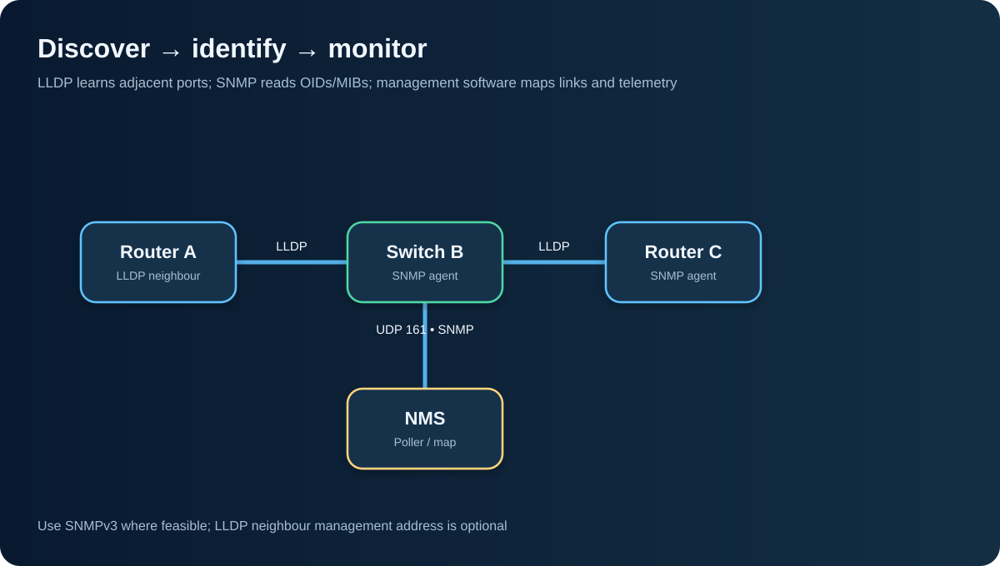

> **Historical notebook-based article; edited November 2026.** My Notion networking note mentions **MG-SOFT MIB Browser**, and my private Python `test_snmp.py` verifies SNMP-reported software data against a device's own CLI. The public commands below use standard OIDs only, not private enterprise OIDs, credentials or device addresses.

## My question: how does a monitoring tool know what is connected to what?

If I plug a router into a switch, how does a **Network Management System (NMS)** know about the new link? Does it just scan IP addresses? Does it ask the router? Or does it look at the physical cables somehow?

The answer is a combination of **discovery protocols, management data and correlation**.



### The three different roles

- **LLDP** (Link Layer Discovery Protocol) lets a device advertise identity and port information to **directly adjacent** network devices. CDP is a Cisco-specific alternative. LLDP is discovery information, not IP route exchange.
- **SNMP** (Simple Network Management Protocol) allows an authorised monitoring system to query and sometimes modify managed data exposed by a device's **SNMP agent**. The monitoring system can poll interface status, counters and many other objects.
- **MIB** (Management Information Base) defines the structure and meaning of management objects. An **OID** (Object Identifier) is a hierarchical numeric identifier for an object. A MIB browser can decode numbers into meaningful symbolic names.

Think of it like this: **LLDP describes a direct neighbour; SNMP reads device information; the NMS joins the observations into a topology and monitoring model.** In practice, topology discovery tools may also use other methods such as CDP, address tables, routing data and ICMP.

## My SNMP and MIB notebook

One small historical note says, *“MIB — useful for SNMP things. MG-Soft MIB Browser for MIBs.”* That statement became more practical after I worked with a Python SNMP test: read device software status/progress/version over SNMP, read the equivalent information from the device's CLI and compare the two views. It matters because **having an OID exposed is not enough**—it should reflect the real operational state.

For a public demonstration, here are standard SNMP objects:

| Object | OID | What it tells me |
|---|---|---|
| `sysDescr.0` | `1.3.6.1.2.1.1.1.0` | System description |
| `sysUpTime.0` | `1.3.6.1.2.1.1.3.0` | Time since the management subsystem was initialised |
| `sysName.0` | `1.3.6.1.2.1.1.5.0` | System name |
| `ifOperStatus` | under `1.3.6.1.2.1.2.2.1.8` | Interface operational state by interface index |

### SNMPv3 on a disposable lab device

```bash
# Replace placeholders with credentials from your own isolated test device
snmpget -v3 -l authPriv -u labuser -a SHA -A '<AUTH_PASS>' \
  -x AES -X '<PRIV_PASS>' 192.0.2.10 1.3.6.1.2.1.1.5.0

# With relevant Net-SNMP MIB packages loaded
snmptranslate -On SNMPv2-MIB::sysName.0
```

Use **SNMPv3 authPriv** where feasible, ideally with well-managed credentials and least-privilege views. SNMPv2c community strings are **not encrypted** and should not be sent over untrusted networks. Avoid putting secrets on a real shell command line where shell history and process inspection can expose them; use appropriate safer tooling and secret management.

## LLDP: learning the next router or switch

On supported Cisco switches/routers:

```text
show lldp neighbors
show lldp neighbors detail
show cdp neighbors detail
show interfaces description
```

An LLDP frame can provide chassis ID, port ID, device details and **optionally** a management address. It may not give a usable neighbour IP address, and even a reported address may be unreachable from my workstation.

The mental model is **discover → validate → connect**:

1. Find the remote chassis/port through LLDP or CDP.
2. Match it to interface counters, link state and expected cabling.
3. Use an **authorised, reachable management IP** and approved credentials for SSH if remote administration is required. LLDP information alone is not permission to access another device.

## How topology mapping software uses these pieces

Tools such as [SolarWinds Network Topology Mapper](https://www.solarwinds.com/network-topology-mapper) can combine SNMP, LLDP, CDP and other discovery techniques to create and update maps. A nice-looking picture is useful, but the **truthfulness of the links** matters more than the artwork. I would verify an apparent connection against interfaces on both ends before relying on the topology in a failure investigation.

### My practical NMS test method

This is the public concept adapted from my older SNMP automation, **not copied code**:

```python
# Pseudocode for a public teaching example
snmp_name = read_snmp_oid(device, "1.3.6.1.2.1.1.5.0")
cli_name = read_authorised_cli(device, "show hostname")
assert normalise(snmp_name) == normalise(cli_name)
```

In actual code, use library timeouts, retries, good error messages and version-specific CLI handling. Test **negative conditions** too: inaccessible SNMP agent, revoked credentials, interface down and unknown OID.

## Why this matters operationally

A useful NMS doesn't just draw a topology. It helps answer: **What is down? Where is the impact? Which other services depend on it? Are counters rising? Did an interface flap?** SNMP and LLDP help build visibility, but trustworthy monitoring also needs change records, alert thresholds, clear ownership and operational response.

**Shreyas Joshi**  
*CCNA certified — Routing and Switching*

**References:** [SNMP architecture RFC 3411](https://www.rfc-editor.org/rfc/rfc3411) · [IF-MIB RFC 2863](https://www.rfc-editor.org/rfc/rfc2863) · [SolarWinds Network Topology Mapper](https://www.solarwinds.com/network-topology-mapper)
