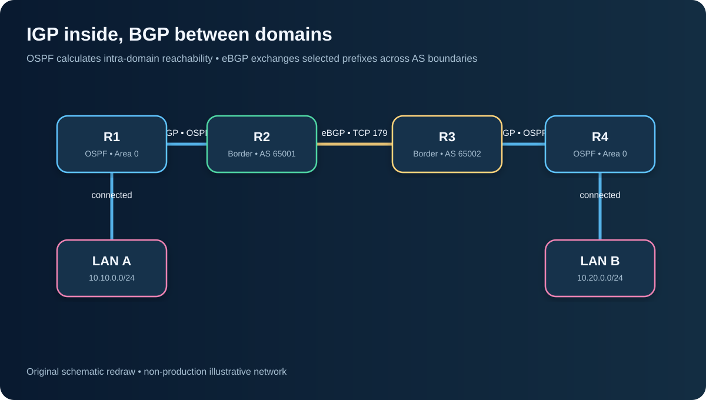

> **Based on my historical Linux networking notes; reconstructed November 2026.** My notebooks reference a Quagga/Raspberry Pi project path and recorded Linux TAP, routes and interface commands. The commands here are educational examples and must be checked against the installed Raspberry Pi OS, FRR and GNS3 versions. This is not an exported historic lab screenshot or employer configuration.

## Is a router just specialised hardware?

I used to think a router was always a box running proprietary network software. Then Linux made the division clearer: **the kernel forwards packets; userspace routing daemons learn routes and install forwarding information.** A Raspberry Pi with multiple network interfaces can be a useful teaching router, subject to throughput, NIC support and reliability limitations.

### What are Quagga and Zebra?

**Quagga** was an open-source routing software suite derived from the original Zebra project. **Zebra** is also the name of the routing-manager daemon used in Quagga's modern successor, **FRRouting (FRR)**. In FRR, `zebra` coordinates RIB/FIB operations while protocol daemons such as `ospfd` and `bgpd` maintain protocol-specific control-plane state. FRR is a continuation/fork of Quagga and is generally a more practical current choice than installing long-obsolete historical Quagga releases.

| Component | Job |
|---|---|
| Linux kernel | Actual IP forwarding; neighbour/route tables; interface state |
| `zebra` | Routing manager: interacts with kernel and routing daemons |
| `ospfd` | Runs OSPF adjacencies and computes OSPF routes |
| `bgpd` | Exchanges and selects BGP routes |
| `vtysh` | Common CLI for interacting with FRR configuration/state |
| GNS3 | Network emulator/orchestrator used to connect virtual routers and hosts |

## My Raspberry Pi learning setup

Assume two Linux/Pi instances on a **private lab** link `10.12.0.0/30`. Modern Raspberry Pi OS is Debian-based, but repositories and package availability depend on release; prefer official FRR packages for your distribution or the documented FRR repository rather than unreviewed installation scripts.

```bash
# Inspect OS and interfaces before making changes
cat /etc/os-release
ip -br address
ip route

# On Debian-based builds where the packages are available
sudo apt update
sudo apt install frr frr-pythontools

# This is a disposable router lab; do not enable forwarding on an
# untrusted shared network without a network/security plan.
sudo sysctl -w net.ipv4.ip_forward=1

# Check/enable relevant daemons in /etc/frr/daemons
sudo grep -E '^(zebra|ospfd|bgpd)=' /etc/frr/daemons
sudo systemctl enable --now frr
sudo vtysh -c 'show version'
```

If `ospfd=no` or `bgpd=no`, edit `/etc/frr/daemons` to enable the one being tested, then restart FRR. For persistent IP forwarding, change your lab's sysctl configuration deliberately rather than assuming `sysctl -w` survives reboot.

### Configure a private OSPF lab in FRR

Here is the principle. Assign the interface IP addresses in Linux first, with a real dedicated lab link and correct interface name. Then use `vtysh` to configure OSPF. A router ID is **not** an interface address you can ping unless you configure it as such.

```text
sudo vtysh
configure terminal
router ospf
 ospf router-id 1.1.1.1
 network 10.12.0.0/30 area 0
end
write memory
show ip ospf neighbor
show ip ospf route
show ip route
```

On the peer, use router ID `2.2.2.2` and its actual `10.12.0.2/30` interface. Verify neighbour state and the Linux-installed routes. Exact FRR commands and syntax can vary with version and daemon features.

## TAP interfaces: connecting Linux to a GNS3 topology

My original notes contained simple commands like `sudo ip addr add ... dev TAP0` and `sudo ip link set TAP0 up`. The crucial detail is that **the TAP interface must first exist**, and Linux interface names are case-sensitive. Here is a modern disposable example:

```bash
sudo ip tuntap add dev tap0 mode tap user "$USER"
sudo ip addr add 10.21.0.1/24 dev tap0
sudo ip link set dev tap0 up
ip address show dev tap0
```

A TAP interface exposes Layer 2 frames into userspace or a virtual network. **Creating `tap0` alone does not connect it to GNS3**. Add the appropriate GNS3 Cloud/TAP binding or bridge in your lab. Host OS, permissions, GNS3 VM networking and container setup can change the exact workflow. Avoid bridging a lab into a corporate LAN.

### Another useful Linux command from my notes

```bash
# Add a route to a training prefix (only if the next hop is on-link/reachable)
sudo ip route add 198.51.100.0/24 via 10.21.0.2 dev tap0

# Clean it up when finished
sudo ip route del 198.51.100.0/24 via 10.21.0.2 dev tap0
```

I now prefer `ip addr`, `ip link` and `ip route` over old `ifconfig` and `route` tools, although old notes are useful for understanding the transition.

## How I would validate the entire lab



- Check Linux interface IP addresses and link state: `ip -br addr`, `ip -s link`.
- Check FRR is actually running and daemons are enabled: `systemctl status frr`, `vtysh -c 'show ip route'`.
- Validate OSPF neighbours before attempting BGP or MPLS.
- Use `tcpdump` or Wireshark to prove protocol packets traverse the intended interface.
- If enabling eBGP, use lab-only ASNs and distinct TCP/IP-reachable peer addresses, then verify BGP prefix exchange and the kernel's installed route.
- Shut a lab link and observe the routing control plane **and** actual traffic recovery.

### Why GNS3 is more than clicking on routers

For me, the value of GNS3 was seeing a concept at three layers: **configuration**, **protocol state**, and **packets**. A successful ping is one data point. The interesting questions are *why* that route won, how fast it recovered after a failure, whether a label was actually present, and whether the observed counters agree with the intended QoS policy.

## The mental model I retain

**Router hardware is not the same thing as routing logic.** The kernel makes forwarding decisions, and routing protocols keep the control-plane data current. Quagga/Zebra taught me that split; FRRouting is the natural modern software lab to revisit it.

**Shreyas Joshi**  
*CCNA certified — Routing and Switching*

**References:** [FRR architecture](https://docs.frrouting.org/en/latest/about.html) · [FRR basic setup](https://docs.frrouting.org/en/latest/setup.html) · [GNS3 documentation](https://docs.gns3.com/)
