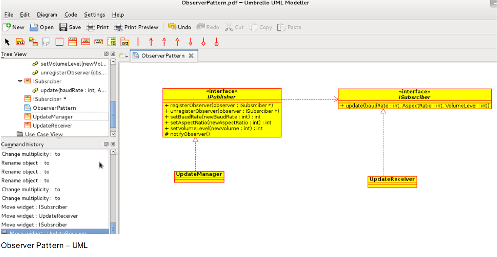
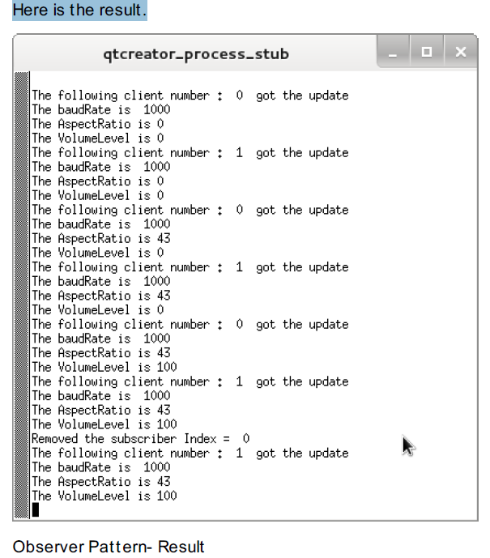

The Observer pattern lets a subject notify interested observers when its state changes. A subject can add or remove observers at runtime; the observers depend on the subject's notification contract rather than on its concrete implementation.

The main example below uses C++ and Qt. A separate Python example is linked near the end.

## Example: broadcasting settings

In a set-top box, changes to default
baud rate, video aspect ratio, and the default volume level needs to be
changed, the broadcast server will send the information to the client – a Set -
top box. So, the software component in the Set -top box, which gets to know
any updates is called the Update Manager, and the interested clients here are
– network component – for baud rate, display component for aspect ratio,
and the av component for the default volume level.

## The publisher and subscribers
The update Manager should notify all of the clients registered with it. These
clients can be network component , display component , and av component in
this example. Also, we should have a flexibility of adding or deleting these
clients at the run-time. So, here the publisher is – Update Manager and
subscribers are network component , av component , and display component.
Also, note that at any point of time any clients can be added or deleted. This
operation is at run-time.

Let’s make a UML representation of it .

The publisher interface defines registration and state changes:



class IPublisher
{
 public:
  virtual ~IPublisher() = default;
    virtual void registerObserver(ISubscriber * observer) = 0;
    virtual void unregisterObserver(ISubscriber * observer) = 0;
    virtual void setBaudRate(int newBaudRate) = 0;
    virtual void setAspectRatio(int newAspectRatio) = 0;
    virtual void setVolumeLevel(int newVolume) = 0;
    protected:
    virtual void notifyObserver() = 0;
};



An interface in C++ is a design convention, not a special language construct. A virtual destructor is important when objects may be deleted through a base-class pointer. The publisher keeps the observer list and calls each observer's update operation when state changes.


class ISubscriber
{
  public:
  virtual ~ISubscriber() = default;
      virtual void update(int baudRate, int AspectRatio, int VolumeLevel) = 0;
};



The subscriber method – update() needs to be invoked by the server,
whenever the event is changed. Each concrete class called client will
implement the update() method. Here is the concrete subscriber class. Here,
we have created a client by registering it with the server. So, the constructor
of client will register with the server.


class UpdateReceiver: public ISubscriber
{
  private:
    int m_baudRate;
    int m_aspectRatio;
    int m_volumeLevel;
    int m_receiverNumber;
    static int updateReceiverTracker;
    /** Update Interface of the client ** /
public:
    /** Constructor -- and registers with the Server or Publisher or        UpdateManager ** /
    UpdateReceiver(IPublisher * updateManager)
    {
      m_receiverNumber = updateReceiverTracker++;
      updateManager->registerObserver(this);
    }
   void update(int baudRate, int AspectRatio, int VolumeLevel)
   {
     m_baudRate = baudRate;
     m_aspectRatio = AspectRatio;
     m_volumeLevel = VolumeLevel;
     qDebug()<<"The following client number : "<< m_receiverNumber<< " got the update ";
     qDebug()<<"The baudRate is "<<baudRate;
     qDebug()<<"The AspectRatio is"<<AspectRatio;
     qDebug()<<"The VolumeLevel is"<<VolumeLevel;
   }
};



int UpdateReceiver::updateReceiverTracker = 0;

Now, the Server/Publisher – the publisher needs to maintain the list of
observers. The observer gets added in the list when the register() method of
publisher is invoked. Here, we have registered the client to server on creation
only – check the constructor. The constructor calls the register() method of
the publisher. So, whenever the event is updated, it notifies to all the
observers. The interface to notify the observers is update(). Thus, a concrete
client needs to implement the update() method.


class UpdateManager: public IPublisher
{
  private:
    QList<ISubscriber * > subscribers;
    int m_baudRate;
    int m_aspectRatio;
    int m_volumeLevel;
  public:
    UpdateManager():m_baudRate(0),m_aspectRatio(0),m_volumeLevel(0)
    {
      qDebug()<<"Update Manager --- Server/Subject Initialized";
      subscribers.clear();
    }
    void registerObserver(ISubscriber * observer)
    {
      subscribers.append(observer);
    }
    void unregisterObserver(ISubscriber * observer)
    {
      int index = subscribers.indexOf(observer);
      if (index >= 0)
      {
        subscribers.removeAt(index);
      }
      qWarning()<<"Removed the subscriber Index = "<<index;
    }
   void setBaudRate(int newBaudRate)
   {
      m_baudRate = newBaudRate;
      notifyObserver();
   }
   void setAspectRatio(int newAspectRatio)
   {
     m_aspectRatio = newAspectRatio;
     notifyObserver();
   }
   void setVolumeLevel(int newVolume)
   {
     m_volumeLevel = newVolume;
     notifyObserver();
   }
protected:
   void notifyObserver()
   {
     foreach( ISubscriber * observer, subscribers )
     {
       observer->update(m_baudRate,m_aspectRatio,m_volumeLevel);
     }
   }
};



Here is the main(). The two clients are created. They both will get the
notification, whenever the event is updated. However, at any time we can
deregister any client . Also, we can add/register more clients.



int main(int argc, char * argv[])
{
  QCoreApplication a(argc, argv);
  IPublisher * AV_UpdateMgr = new UpdateManager();
  ISubscriber * AV_UpdateReceiver = new UpdateReceiver(AV_UpdateMgr);
  ISubscriber * NW_UpdateReceiver = new UpdateReceiver(AV_UpdateMgr);
  /** Server Updating the values ** /
  AV_UpdateMgr->setBaudRate(1000);
  AV_UpdateMgr->setAspectRatio(43);
  AV_UpdateMgr->setVolumeLevel(100);
  AV_UpdateMgr->unregisterObserver(AV_UpdateReceiver);
  AV_UpdateMgr->setVolumeLevel(100);
  delete AV_UpdateReceiver;
  delete AV_UpdateMgr;
  delete NW_UpdateReceiver;
  return a.exec();
}



Here is the result.

The entire code can be downloaded below. Here the code is written in Python.

[Source_code_ObserverPattern](https://drive.google.com/open?id=1SPHpEjtD0MnGXIcL5ZEL7lPqAvEdQsoc)

**When to use Observer Pattern?**
Whenever an update is to be published to multiple clients. It is like one to
many relationship.

**Advantage of Observer Pattern -**
With the help of interface, the subject/publisher doesn’t need to know
anything about the observers.

**Disadvantage of Observer Pattern -**
The subject /publisher may send multiple updates even when the component is
not interested. For example, baud rate change is not an interested event for
the display module. However, the client will get it . Nevertheless, a client can
have an internal logic, where they can check for the interested event field
update.

Examples of Observer Pattern – Signal/Slots in Qt .
