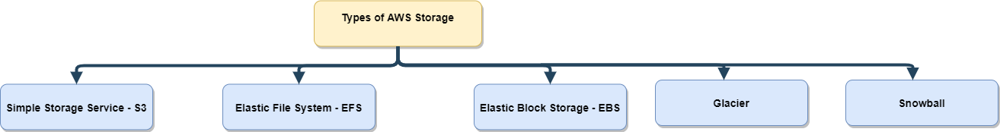

This article introduces several AWS storage and data-transfer services. Product names,
classes, and availability can change; consult current AWS documentation before choosing
a service.

## Storage service categories
The diagram groups object, file, and block storage with archival and data-transfer
services. These are different service categories rather than five interchangeable storage
types.

## Amazon Simple Storage Service (S3)
Amazon S3 stores objects in buckets and is accessed through AWS APIs and compatible
tools. It supports many data types, including documents, media, backups, and application
data. Access, durability, availability, and cost depend on the selected storage class,
configuration, and features.

## Amazon Elastic File System (EFS)
Amazon EFS is a managed NFS file system that can be mounted by supported clients,
including Linux instances. Access is controlled through network and file-system policies.

## Amazon Elastic Block Store (EBS)
Amazon EBS provides block volumes commonly attached to EC2 instances. Attachment options
and supported workflows depend on the volume type and configuration.

## Amazon S3 Glacier storage classes
Amazon S3 Glacier is a family of S3 storage classes for archival data. Retrieval time and
cost depend on the selected class and retrieval option.

## AWS Snow Family
AWS Snow Family devices support selected offline data-transfer and edge-computing
workflows. They are not a general replacement for online transfer; service availability
and product names vary by Region and use case.

Choose a service based on access patterns, performance, durability, recovery objectives,
security, and total cost—not only the broad storage category.
