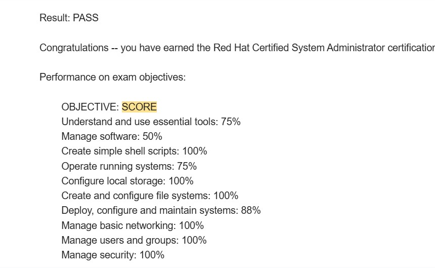

This article is for anyone preparing for the **Red Hat Certified System Administrator (RHCSA)** exam.

I recently passed the RHCSA exam on RHEL 10. Although I already had significant Linux experience as a developer—particularly in embedded Linux, kernel development and system programming—the RHCSA preparation still taught me many valuable system administration concepts.

I currently work in a leadership role where I no longer write code regularly and do not have access to a Linux environment as part of my daily work. Despite that, I was able to prepare for and pass this practical exam.

In this article, I will explain the approach that worked for me and share the most important lessons I learned.

**Create a RHEL practice environment**

Many candidates practise using Rocky Linux, AlmaLinux or another distribution compatible with Red Hat Enterprise Linux. These distributions can be useful, but I strongly recommend creating a [Red Hat Developer account](https://developers.redhat.com/register) and downloading RHEL directly.

I took the RHEL 10 version of the RHCSA exam, so practising on RHEL 10 helped me become familiar with the same operating system family used in the exam.

Always check the current [RHCSA EX200 exam objectives](https://www.redhat.com/en/services/training/ex200-red-hat-certified-system-administrator-rhcsa-exam) before finalising your preparation plan, because objectives and exam versions can change.

**Virtual machine setup**

I used VMware to create my virtual machines. My personal preference is VMware over Oracle VirtualBox because I find its guest integration, snapshot management and other virtual machine features more convenient.

To download VMware, create a Broadcom account and use the relevant VMware download section in the [Broadcom Support Portal](https://support.broadcom.com/).

Once you have installed and configured a clean RHEL system, create a snapshot of that pristine installation. You can then experiment freely and revert to the clean state whenever necessary.

This can save a considerable amount of preparation time.

**Understand patterns instead of memorising commands**

The most important lesson from my preparation is this:

**Do not try to memorise every command. Understand the pattern, structure and purpose behind it.**

For every topic, ask yourself:

1. What problem does this command solve?
2. What is the basic command structure?
3. Which parts change depending on the task?
4. How can I verify that the command worked?
5. Will the configuration remain after a reboot?

For example, when working with systemd, inspect existing service and timer definitions.


systemctl cat sshd.service
systemctl cat systemd-tmpfiles-clean.timer


Existing unit files provide useful examples of the correct structure. You can study these examples and adapt the same pattern when creating a service or timer for an exam task.

The objective is not to memorise an entire configuration file. It is to recognise its structure and understand which sections and values are required.

**Learn to navigate man pages efficiently**

The RHCSA exam is practical, so knowing how to find information quickly is extremely important.

You should become comfortable navigating Linux man pages rather than depending entirely on memory.

For example:

1. Section 8 normally contains system administration commands.
2. Section 5 normally contains file formats and configuration-file syntax.
3. Section 7 contains conventions, protocols and broader documentation.


man 8 useradd
man 5 fstab
man 5 systemd.service


For NetworkManager and `nmcli`, explore the available documentation and examples.


man nmcli
man 7 nmcli-examples


The exact documentation available can vary between versions. Use `man -k` to discover related pages.


man -k nmcli


Learning how to search the documentation is often more valuable than memorising dozens of command variations.

**Use examples already available on the system**

RHEL contains many useful examples, default configuration files and existing systemd units. Use them.

When asked to create or modify something, first check whether the system already contains a similar example. You can then reproduce the pattern and adjust it for the task.

Useful techniques include:


systemctl cat sshd.service
man -k systemd
rpm -qd bash
ls /usr/share/doc/


The main idea is to use the resources built into the operating system. The exam is not only testing whether you remember commands. It is also testing whether you can operate as a practical Linux administrator.

**Recognise simple command patterns**

Many Linux commands become easier when you understand their basic pattern.

For example, an AWK rule commonly follows this structure:


pattern { action }


A simple example is:


awk '$3 > 1000 { print $1 }' /etc/passwd


In this example:

1. `$3 > 1000` is the pattern or condition.
2. `{ print $1 }` is the action.

Once you understand this structure, you can adapt it to many different tasks.

The same principle applies to commands such as `find`, `grep`, `sed`, `tar`, `chmod` and `nmcli`. Instead of memorising every possible command, understand the building blocks.

When you start seeing patterns everywhere, Linux administration becomes much easier.

**Understand LVM as a structure**

Logical Volume Management was relatively new to me, but it became much easier once I understood the structure behind it.

The simplified LVM hierarchy is:


Disk or partition
        |
        v
Physical Volume (PV)
        |
        v
Volume Group (VG)
        |
        v
Logical Volume (LV)
        |
        v
Filesystem
        |
        v
Mount point


The major components are:

1. **Physical Volume (PV):** A disk or partition prepared for use by LVM.
2. **Volume Group (VG):** A storage pool created using one or more physical volumes.
3. **Logical Volume (LV):** A flexible virtual storage volume created from the volume group.
4. **Filesystem:** The filesystem created on the logical volume, such as XFS or ext4.
5. **Mount point:** The directory where the filesystem becomes accessible.

Each LVM physical volume is divided into fixed-size **physical extents**. A logical volume consists of **logical extents** that are mapped to those physical extents.

LVM provides flexible storage allocation. For example, after a virtual disk has been enlarged in a cloud or virtualised environment, LVM can help make the additional capacity available to a logical volume and its filesystem.

However, LVM does not independently increase the size of the underlying physical or virtual disk.

A typical storage-extension flow may look like this:


Enlarge the physical or virtual disk
        |
        v
Enlarge the partition or physical volume, if required
        |
        v
Make the space available to the volume group
        |
        v
Extend the logical volume
        |
        v
Grow the filesystem


Conceptually, you must extend the logical volume and then grow the filesystem. The `-r` option of `lvextend` can perform both operations together when the filesystem is supported.


lvextend -r -L +1G /dev/vg_data/lv_data


Commands such as `pvs`, `vgs`, `lvs`, `lvextend`, `xfs_growfs` and `resize2fs` become easier to remember when you understand where each command fits within this structure.

**Practise verification after every task**

Completing a command is not enough. You should always verify the result.

For example:

1. After creating a user, use `id` or inspect `/etc/passwd`.
2. After configuring a service, use `systemctl status` and `systemctl is-enabled`.
3. After modifying a firewall rule, inspect the active configuration.
4. After creating a mount, use `findmnt`, `lsblk` or `df`.
5. After configuring networking, use `nmcli`, `ip address` and an appropriate connectivity test.
6. After creating a logical volume, use `pvs`, `vgs`, `lvs` and `lsblk`.

Build the following habit:


Perform the task -> Verify the task -> Confirm persistence


Persistence is especially important. A configuration that works now but disappears after reboot may not satisfy the exam requirement.

**Practise under time pressure**

The RHCSA exam is not extremely difficult conceptually, but it is also not a simple exam.

The main challenge is completing multiple practical tasks within a limited period. Unlike a multiple-choice exam, you must configure a real system and make sure that your work is correct and persistent.

During preparation, practise complete task sets rather than practising only individual commands.

Your task sets may include topics such as:

1. Users and groups
2. Permissions and ACLs
3. Storage and LVM
4. Filesystems and persistent mounts
5. Networking
6. SELinux
7. Firewalld
8. Systemd services and timers
9. Package management
10. Scheduled tasks
11. File searching and text processing
12. Simple shell scripting

Always align your final topic list with the official objectives for the version of the exam you have scheduled.

Completing full practice sets within a fixed period helps improve your technical knowledge, speed, confidence, troubleshooting ability and time management.

**Keep your commands simple**

During the exam, use the simplest reliable solution.

Avoid creating a complicated command when a straightforward one can complete the task. Complex commands are harder to troubleshoot and easier to mistype.

Also avoid making unnecessary system changes. Read each task carefully, identify exactly what is being requested, complete it, verify it and move forward.

**My final thoughts**

The RHCSA exam is achievable, even for someone who is no longer working directly with Linux every day.

My previous Linux experience certainly helped, but the exam still required focused preparation—particularly in areas such as LVM, system administration, networking, SELinux, systemd and persistent configuration.

The most effective preparation strategy is not to memorise hundreds of commands. Instead:

1. Understand the purpose of each concept.
2. Recognise common command and configuration patterns.
3. Learn to use man pages and built-in examples.
4. Practise every task directly on RHEL.
5. Verify every configuration.
6. Repeat complete exercises under time pressure.

Once you understand the structures and patterns behind Linux administration, the RHCSA exam becomes much more manageable.

The exam is practical, and your preparation should be practical too.