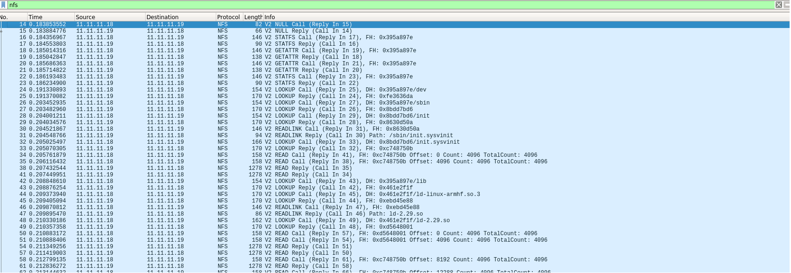

This walkthrough records an NFS-root setup for an Avnet MicroZed Zynq board and an Ubuntu 18.04 development VM. It is specific to that older environment and is not a current production recipe.

> **Security:** NFSv2 is obsolete and should not be enabled on an exposed or production network. The original setup also used `no_root_squash`, which lets a remote root user act as root on the exported files. The safer export example below omits that option and limits access to a trusted lab subnet. Prefer a supported NFS version for new systems.

## Install the NFS server

Install the server and client utilities if they are not already present.


$sudo apt-get install --reinstall nfs-common nfs-kernel-server


## Check the enabled NFS versions

This original kernel used NFSv2. Ubuntu 18.04 did not enable that version in my configuration. Do not copy this compatibility change to a current system; update the embedded kernel and use a supported NFS version instead.

**How to find what NFS Server version is enabled or disabled by Ubuntu**

$sudo cat /proc/fs/nfsd/versions
  -2 +3 +4 +4.1 +4.2


The '-2' here tells that the nfsd is disabled for the version number '2'.
Thus, we need to enable the version 2 for NFS server.

For reference only, these were the 2020 lab steps I used to enable NFSv2 on Ubuntu 18.04:

Go to the following file.

$sudo gedit /etc/default/nfs-kernel-server 


Now, edit this file to include the version 2. First, find the line saying - "RPCNFSDCOUNT=8".
Change this to include Version 2 also. Update/edit as follows to enable NFSv2 on Ubuntu Linux.


# Number of servers to start up
RPCNFSDCOUNT="8 -V 2"


Here is how my entire file looks like.


# Number of servers to start up
RPCNFSDCOUNT="8 -V 2"

# Runtime priority of server (see nice(1))
RPCNFSDPRIORITY=0

# Options for rpc.mountd.
# If you have a port-based firewall, you might want to set up
# a fixed port here using the --port option. For more information, 
# see rpc.mountd(8) or http://wiki.debian.org/SecuringNFS
# To disable NFSv4 on the server, specify '--no-nfs-version 4' here
RPCMOUNTDOPTS="--manage-gids"

# Do you want to start the svcgssd daemon? It is only required for Kerberos
# exports. Valid alternatives are "yes" and "no"; the default is "no".
NEED_SVCGSSD=""

# Options for rpc.svcgssd.
RPCSVCGSSDOPTS=""


Now, restart the NFS Kernel service.

$sudo systemctl restart nfs-kernel-server.service


***Check the nfsd version afterwards**

cat /proc/fs/nfsd/versions
+2 +3 +4 +4.1 +4.2


+2 means it is enabled. 

**How to check the NFS Server status**
Ubuntu 18.04 uses Systemd to manage services.
In order to check the nfs server status. We could run the following command.

shreyas@shreyas-VirtualBox:~$sudo systemctl status nfs-server
● nfs-server.service - NFS server and services
   Loaded: loaded (/lib/systemd/system/nfs-server.service; enabled; vendor preset: enabled)
   Active: active (exited) since Fri 2020-03-06 12:36:08 AEST; 11min ago
  Process: 2908 ExecStopPost=/usr/sbin/exportfs -f (code=exited, status=0/SUCCESS)
  Process: 2907 ExecStopPost=/usr/sbin/exportfs -au (code=exited, status=0/SUCCESS)
  Process: 2906 ExecStop=/usr/sbin/rpc.nfsd 0 (code=exited, status=0/SUCCESS)
  Process: 2917 ExecStart=/usr/sbin/rpc.nfsd $RPCNFSDARGS (code=exited, status=0/SUCCESS)
  Process: 2916 ExecStartPre=/usr/sbin/exportfs -r (code=exited, status=0/SUCCESS)
 Main PID: 2917 (code=exited, status=0/SUCCESS)

Mar 06 12:36:07 shreyas-VirtualBox systemd[1]: Starting NFS server and services...
Mar 06 12:36:08 shreyas-VirtualBox systemd[1]: Started NFS server and services.


## Export the root filesystem
You need to be very careful while extracting the microzed root file system. If accidentally,
you place the microzed root file system on your machine's root file system then nothing will work. The reason is that microzed root file system is built for ARM and not X86. So, be super
careful while extracting the microzed root file system. Here is how I do.

 $mkdir -p /home/shreyas/rootfs_microzed
 $cd /home/shreyas/rootfs_microzed
 $tar -xvf core-image-minimal-microzed-zynq7-20200228041644.rootfs.tar.gz ./


**Set permissions for the root filesystem**

sudo chown nobody:nogroup rootfs_microzed


Add a restricted export for the trusted development subnet in `/etc/exports`. Do not replace the subnet with `*` or expose this development root filesystem to an untrusted network.


$sudo vim /etc/exports
/home/shreyas/rootfs_microzed  11.11.0.0/16(rw,sync,root_squash,no_subtree_check)


Now, run the following command to see whether you are exporting this folder correctly or not.
The below command and the output tells me that I am exporting the rootfs_microzed folder through 11.11.0.0/16 interface.

shreyas@shreyas-VirtualBox:~/microzed/poky/u-boot-xlnx(master)$sudo exportfs
[sudo] password for shreyas: 
/home/shreyas/rootfs_microzed
		11.11.0.0/16


**Other primary services to check for**
You need to ensure that these services are running properly. Otherwise, the above command can
fail.

$sudo systemctl enable rpcbind.service
$sudo systemctl enable nfs-kernel-server


**How to re-export the NFS kernel server folder**
This pretty simple. You just need to run the following command in order to re-export 
the folders.

$sudo exportfs -ra


**Firewall note:** NFS may use several RPC services and ports. Do not open all traffic from a broad subnet as a shortcut. Configure the firewall for the exact NFS version and services in use, and keep the lab network isolated.

## Configure the MicroZed client
If you have followed my tutorial on
[bringing up zedboard](https://joshis1.github.io/embedded_linux/2020/02/02/Zedboard_Yocto.html)
then this is pretty straight forward. By default kernel configuration, the zynq zedboard will enable the NFS version 2. 

**Setting up Bootargs**
This is pretty important step. What I have done is that I have changed the uboot uEnv.txt 
bootargs to 

bootargs=earlyprintk console=ttyPS0,115200 root=/dev/nfs ip=dhcp nfsroot=11.11.11.19:/home/shreyas/rootfs_microzed rw rootwait devtmpfs.mount=1


or you can change the bootargs on the uboot prompt.

set bootargs "earlyprintk console=ttyPS0,115200 root=/dev/nfs ip=dhcp nfsroot=11.11.11.19:/home/shreyas/rootfs_microzed rw rootwait devtmpfs.mount=1"


Here 11.11.11.19 is my Ubuntu 18.04 interface IP address. So, the above command will read the
NFS folder rootfs_microzed from the nfs server 11.11.11.19. The earlyprintk ensures that we 
see some log messages on the serial port until the kernel serial port is setup by the kernel.
The console parameters are same - device - ttyPS0 and the baud rate 115200.

Here is the core-image-minimal-microzed-zynq tar rootfs tar file for you to download.
[microzed root fs](https://drive.google.com/open?id=1XJVQ7y7FuixQ0IoXNBwGXZqgJWz8sQe5)

**Troubleshooting NFS in general**

Ensure that the embedded zynq kernel has the following configuration turned on.


CONFIG_ROOT_NFS=y
CONFIG_NFS_FS=y
CONFIG_NFS_V2=y
CONFIG_NFS_COMMON=y
CONFIG_LOCKD=y
CONFIG_LOCKD_V4=y


Here is the way to check these configurations in yocto

bitbake -c menuconfig virtual/kernel


In case the above command fails, then do install the ncurses package so that the graphics 
can be rendered.


$sudo apt-get install ncurses-devel


Now, check the NFS configuration in the kernel, in the menuconfig do the following.
Escape and forward slash i.e. '/' and type NFS in the search configuration parameter window.
You should check for NFS_COMMON , NFS_FS, NFS_V2, ROOTFS_NFS. They all should be set to 'y'.

After changing the menuconfig, you might need to recompile the kernel. In Yocto, we do this using the following command.

$bitbake virtual/kernel -c cleansstate
$bitbake virtual/kernel -c compile -f


Also, if it is still not working then it worth to check using wireshark and check for NFS protocol. Here is the screen shot of wireshark. You should see something like this. Here 11.11.11.19 is the server ip address and 11.11.11.18 is the NFS client i.e. zynq zedboard.

This brings an end to this article.