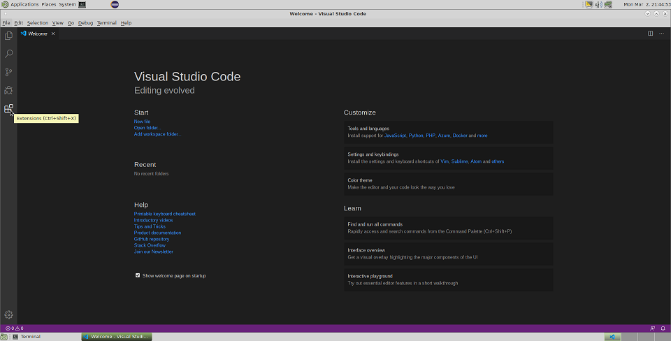
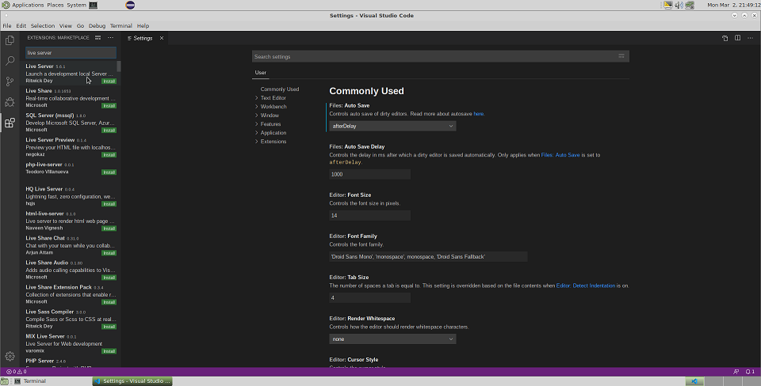
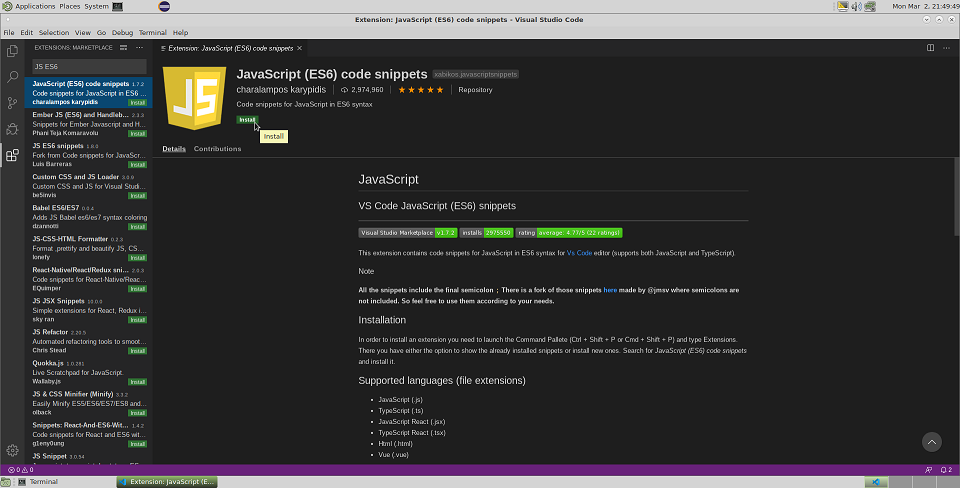
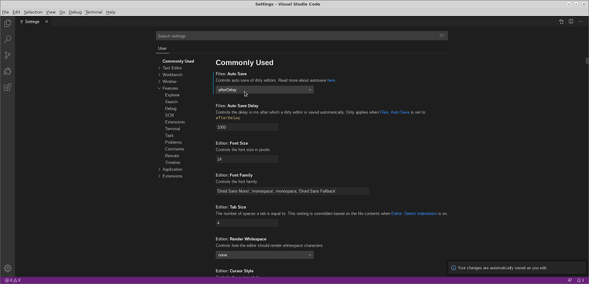
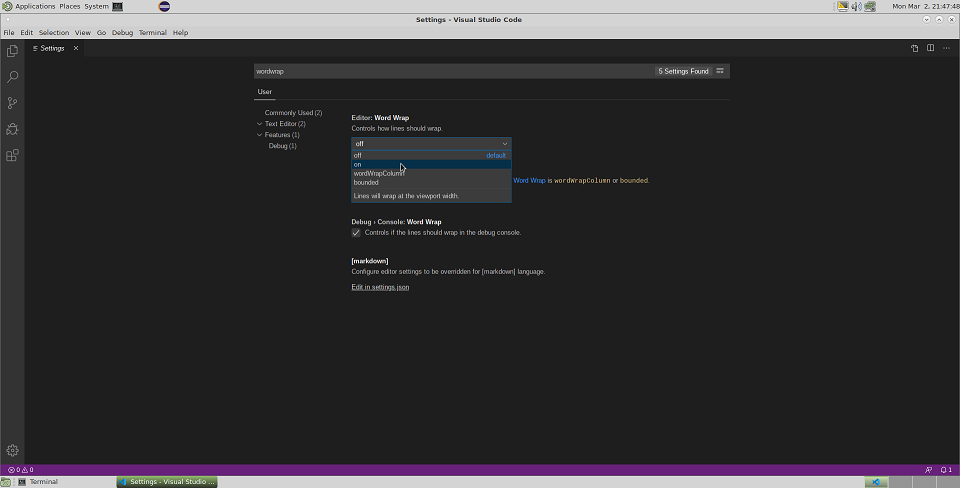
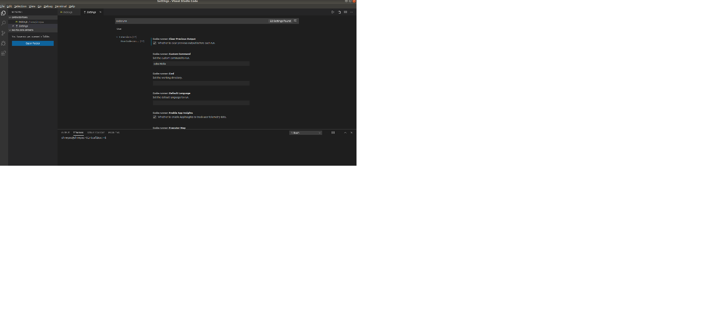
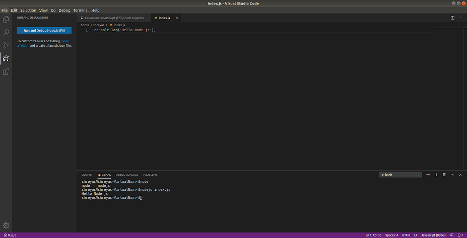
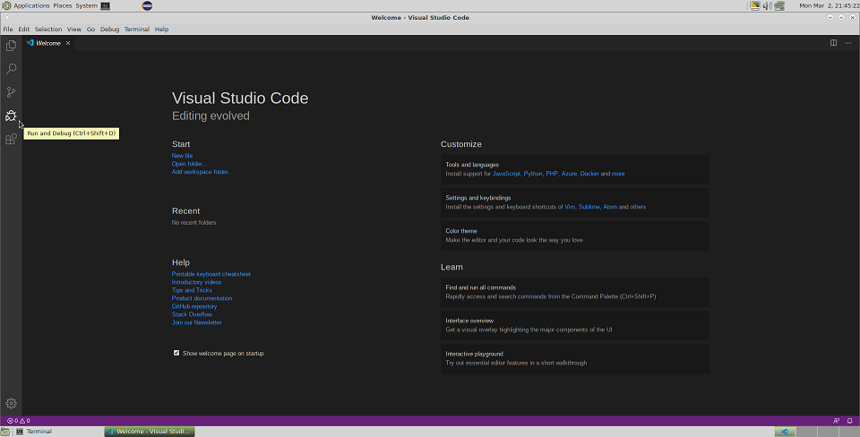

This historical guide records a Visual Studio Code setup on Ubuntu 18.04. VS Code,
Node.js, and extensions change over time; check the current documentation and review an
extension's publisher, permissions, and maintenance status before installing it.

Install a supported Node.js release using the current instructions for your operating
system. The command below is an example from the original Ubuntu environment and may
install an outdated version:


$sudo apt-get install nodejs


The screenshots show the interface and extensions available when this article was
written; menu names and marketplace listings may have changed.

## Extensions
Visual Studio Code features can be added through extensions in the Visual Studio
Marketplace.

## LiveServer extension
The Live Server extension can serve local files and refresh the browser when files change.
Its behavior depends on the extension version and project configuration.

## Use Standard Javascript version i.e. ECMA 6
The screenshot documents an older ECMAScript-related extension. Modern VS Code includes
JavaScript and TypeScript language support; confirm that any additional extension is
still maintained and needed.

Here is the screen shot

## Auto Close tag
This will help to automatically close the tag.
Here is the description about it.
[Auto Close tag](https://marketplace.visualstudio.com/items?itemName=formulahendry.auto-close-tag)

## Auto rename tag
This will help to automatically rename the closing or opening tag when
you change one of the tag. Here is the description about it.

[Auto rename tag](https://marketplace.visualstudio.com/items?itemName=formulahendry.auto-rename-tag)

## babel ES6/ES7
This extension link is retained for historical reference. Prefer current language tooling
and check that any linter or syntax-highlighting extension is actively maintained.

[babel ES6/ES7](https://marketplace.visualstudio.com/items?itemName=dzannotti.vscode-babel-coloring)

## Settings that will help your project
a) Auto Save the changes  - after certain delay.

b) wordwrap turn to on - so that the long line falls back to next line.

c) code-runner.clearPreviousOutput: true - so that you don't have to clear the terminal output all the time manually.

Here is the working example code that runs on the IDE.

Also, you could use the run and debug button to run the code.

The original screenshots were captured on Ubuntu 18.04.

Another great resource for javascript programming is the online IDE.
This is my favourite IDE.

[codepen](https://codepen.io/pen/)

## Resources to learn javascript
FreeCodeCamp and the MDN JavaScript Guide are useful starting points for learning and
practice.

## Documentation for javascript
- [MDN JavaScript Guide](https://developer.mozilla.org/en-US/docs/Web/JavaScript/Guide)
- [MDN JavaScript Reference](https://developer.mozilla.org/en-US/docs/Web/JavaScript/Reference)
