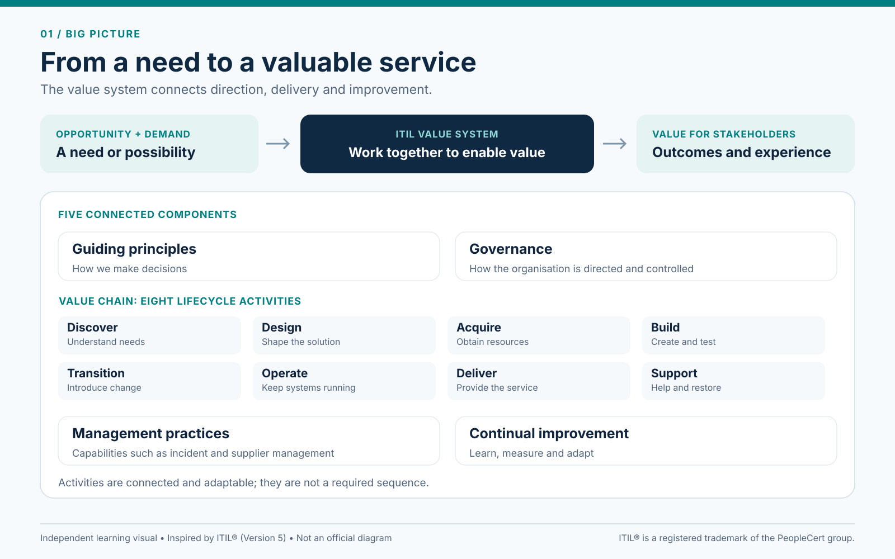
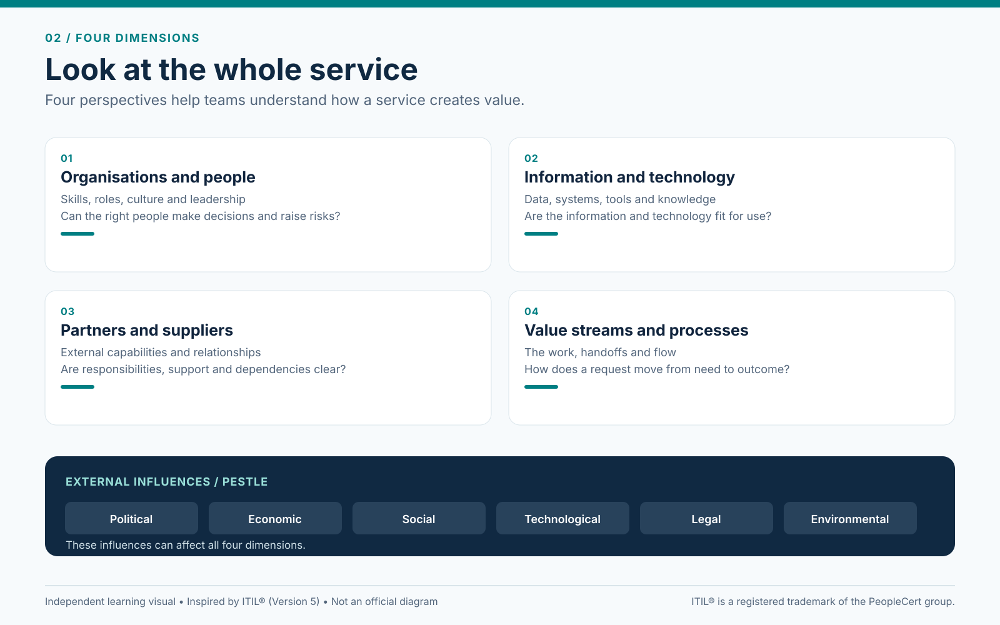
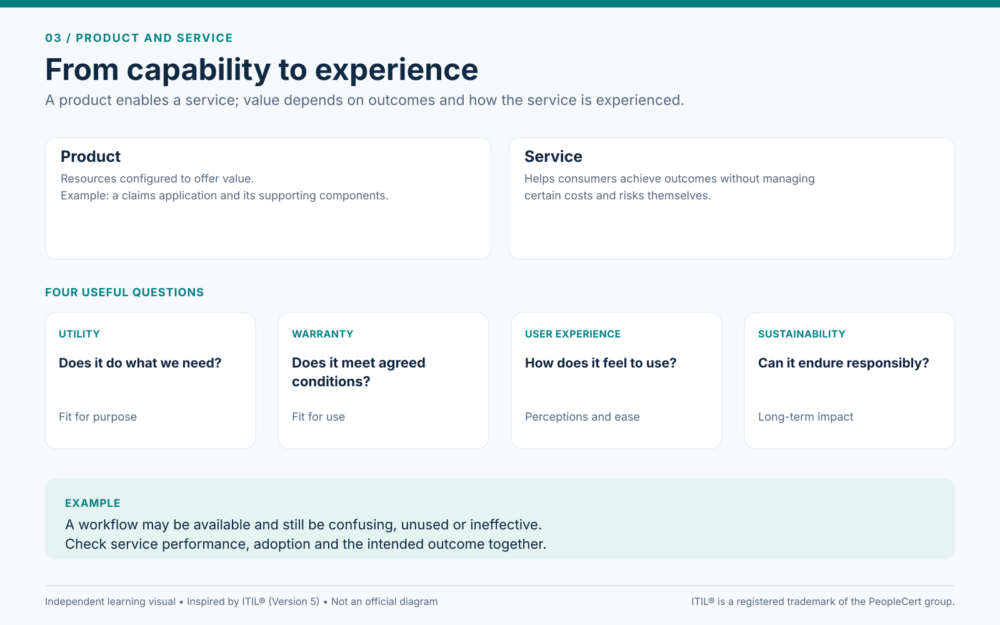
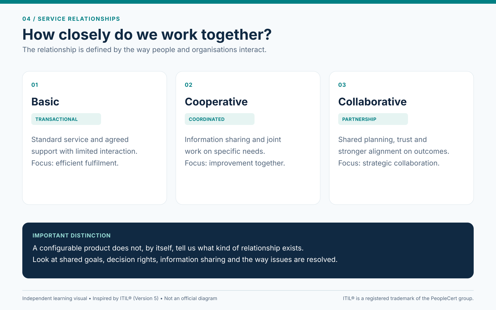
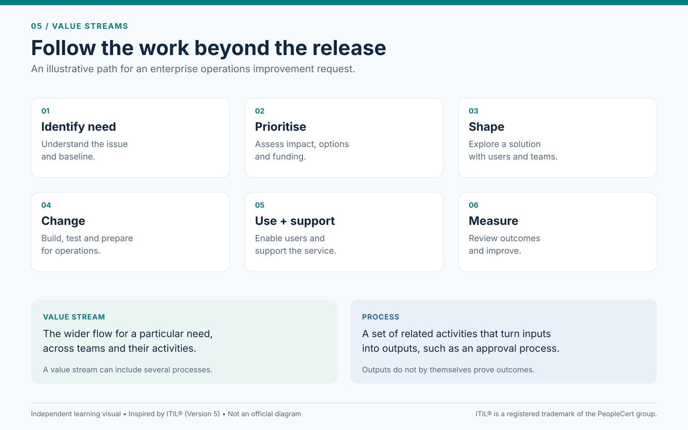
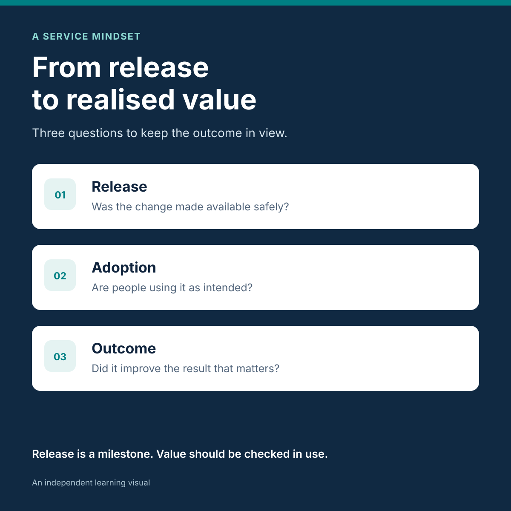

**Status:** Personal learning notes while preparing for the exam. Certification has not yet been obtained.

*ITIL® Foundation (Version 5): study notes and enterprise examples*

**How to use this page:** Read the quick map first, then use the examples and questions to practise explaining the concepts in your own words. Examples are illustrative and do not describe a particular employer or actual result. Consult your official course material for the exact wording expected in your exam.

## 1. The central idea

A digital product or service can be delivered on time and still fail to produce the intended result. Good product and service management connects a real need to a useful, reliable service, adoption by the people who use it, and evidence of an outcome.

**Example:** A claims feature is released successfully. That is an output. Faster, accurate processing and a better member experience would be potential outcomes. Measure them after release rather than assuming they happened.

### The ITIL Value System: the big picture

Opportunity and demand enter a value system in which an organisation's components and activities work together to facilitate value creation. Its five components are:

1. **Guiding principles:** Recommendations that help people make decisions across different situations.
2. **Governance:** The means by which the organisation is directed and controlled.
3. **Value chain:** The high-level activities the organisation combines to create and deliver value.
4. **Management practices:** Organisational resources and capabilities used to perform work or achieve objectives, such as incident management and supplier management.
5. **Continual improvement:** Ongoing work to improve products, services, practices and results.

Think of the five as interconnected, rather than as mandatory concentric layers. Opportunity and demand are inputs; value is facilitated through collaboration and may be experienced differently by different stakeholders. Value does not arise automatically because a project or process is complete.

### Seven guiding principles

| Principle | A practical prompt |
| --- | --- |
| **Focus on value** | Whose outcome will this improve? |
| **Start where you are** | What useful data, capability or process already exists? |
| **Progress iteratively with feedback** | Can we test a useful increment and learn from users? |
| **Collaborate and promote visibility** | Are the right people involved, and can they see risks and decisions? |
| **Think and work holistically** | What happens across teams, systems and the wider service? |
| **Keep it simple and practical** | Which activities help achieve the outcome? |
| **Optimise and automate** | Can we first improve the workflow, then automate where it makes sense? |

The principles work together and are adapted to context; they are not a substitute for judgement.

### ITIL 4 and ITIL Version 5

The framework builds on earlier concepts. In Version 5 the product and service lifecycle identifies **Discover, Design, Acquire, Build, Transition, Operate, Deliver and Support**. The eight activities are adaptable and interconnected; they are not a mandatory sequential waterfall or a checklist that every request must pass through in the same order. Do not confuse this list with the six ITIL 4 service value chain activities. The organisation adapts activities and practices to form its own value chains and streams.

## 2. Value, products and services

| Term | Practical explanation | Illustrative example |
| --- | --- | --- |
| **Product** | A configuration of resources created to offer value. | A claims application, its configuration and supporting components. |
| **Service** | Helps consumers achieve outcomes without having to manage certain costs and risks themselves. | A managed claims platform, including agreed access and support. The consumer still has some costs, risks and responsibilities. |
| **Output** | Something produced by an activity. | A deployed feature and an updated procedure. |
| **Outcome** | A result enabled by one or more outputs. | Claims staff can complete a specified task more quickly and accurately. |
| **Value** | The perceived benefits, usefulness and importance experienced by a stakeholder. | Members receive a more timely service; staff spend less effort on rework. |
| **Value co-creation** | Provider and consumer contribute through their relationship and use of a service. | Teams design and operate a feature; business staff define needs, adopt it and give feedback. |

An internal technology team can act as a service provider to business teams. Roles depend on the situation: an operations manager may represent the customer, an employee may be a user, and a budget owner may act as sponsor. One person can hold more than one role. The service can also involve external providers and shared responsibilities.

### Four useful perspectives on quality and experience

| Concept | Plain language | Example question |
| --- | --- | --- |
| **Utility** | What the service does; is it fit for purpose? | Can authorised staff process the required claim type? |
| **Warranty** | Assurance that it meets agreed conditions; is it fit for use? | Is it available, secure and performant when needed? |
| **User experience** | How people perceive and feel about their interactions with the service. | Can staff navigate the workflow without avoidable confusion? |
| **Sustainability** | Whether the approach can be maintained responsibly over time. | Can the solution remain viable with its environmental, social and economic effects considered? |

An availability figure, such as 99.9%, is an illustrative target unless an actual agreement says otherwise. Availability is one aspect of warranty, not the whole of it. A system can meet an availability target yet still be difficult to use or fail to support the right business outcome.

## 3. Service relationships

| Relationship | Typical pattern | Example |
| --- | --- | --- |
| **Basic** | Mostly standardised and transactional, with limited interaction. | Standard software accessed under a simple support agreement. |
| **Cooperative** | More coordination, information sharing and joint work on specific needs. | A supplier and customer coordinate configuration and issue resolution. |
| **Collaborative (partnership)** | Closer alignment, shared planning and trust, often involving strategic discussion. | An organisation and strategic supplier jointly plan service improvements and manage dependencies. |

These are useful patterns, not labels that can be assigned from the software architecture alone. A configurable platform can be used under any of these relationships; extensibility and the software design open/closed principle do not automatically make the commercial relationship cooperative or collaborative.

### How can a vendor relationship become more collaborative?

- Agree on shared outcomes as well as the contractual obligations of each party.
- Make decision rights, escalation paths, dependencies and accountabilities visible.
- Share relevant service measures, risks and constraints early.
- Involve the right vendor and internal specialists in discovery, design and retrospectives.
- Review recurring problems and improvement actions together. A commercial customer–supplier relationship and genuine collaboration can coexist.

## 4. Four dimensions and external influences

The four dimensions provide different lenses for considering a product or service holistically. They interact; none should be assumed to be sufficient on its own.

| Dimension | What to consider | Financial-services example |
| --- | --- | --- |
| **Organisations and people** | Roles, skills, leadership, structure, culture and capacity. | Business, delivery and support teams understand their responsibilities and can raise concerns. |
| **Information and technology** | Applications, data, knowledge, infrastructure and automation. | Claim data, integration monitoring, access controls and support information are fit for use. |
| **Partners and suppliers** | Relationships and dependencies with external parties. | Vendor support, contracts, escalation and ownership across platforms are clear. |
| **Value streams and processes** | How work flows across teams and how activities connect. | A request travels from business need through prioritisation, change, use and feedback. |

External influences can be considered through **PESTLE**: political (policy direction), economic (costs and market conditions), social (member needs and expectations), technological (new tools and capabilities), legal (applicable law and regulation), and environmental (climate and sustainability pressures). These examples are prompts, not a legal assessment. They can influence all four dimensions.

### Culture and Conway's law

- Psychological safety makes it easier for people to raise risks and bad news early. Leaders still need clear ownership, constructive challenge and follow-through.
- Conway's law is a useful lens: communication structures can shape system design. It can help generate hypotheses about handoffs or integration issues, but it does not by itself prove the cause of a particular problem. Check facts and consider other contributors, such as changing requirements, funding or technical constraints.
- Cross-functional teams can reduce handoffs, but a team size or a single operating model is not universally correct. Consider capability, dependencies and organisational context.

## 5. Value chain, value stream and process

| Concept | Main question | Example |
| --- | --- | --- |
| **Value chain** | What high-level activities can the organisation combine? | Discover, design, acquire, build and other lifecycle activities. |
| **Value stream** | How does work flow for a particular need, from trigger towards value? | An operations improvement request, from identifying the need through use and checking results. |
| **Process** | What coordinated activities turn defined inputs into outputs? | A funding approval, change assessment or access request process. |

A value stream can include several processes and teams, including steps before a delivery team starts building. A process can also be used by multiple value streams.

**Your question: if the value stream does not realise value, does it become a process?** No. It is still a value stream, but it may be ineffective or may not yet have produced the desired outcome. A process is defined by the way related activities transform inputs into outputs; a value stream describes the wider flow for a particular need. Neither label guarantees success.

### Example: an operations improvement request

1. **Need identified:** Operations staff identify rework. Agree whose problem it is and collect a baseline.
2. **Triage and prioritise:** Product or portfolio leads assess impact, urgency, options and dependencies. Funding or governance approval may be needed.
3. **Discover and design:** Business, technology, service and supplier representatives explore possible solutions and how to measure success.
4. **Build and transition:** Teams configure or develop, test, release, prepare support and enable users. The activities can overlap or repeat.
5. **Use and support:** Operations adopt the change; service and product teams support and monitor it.
6. **Measure and improve:** Compare processing time, errors, adoption and user feedback against the baseline. Investigate if outcomes do not improve.

**Where does co-creation happen?** Across the relationship: defining the problem together, designing and testing, preparing for use, adopting the change and improving it. It is not restricted to the last step. Business cases and approval can be legitimate parts of the flow; look for delay or unnecessary handoffs without assuming governance is waste.

## 6. Eight lifecycle activities in a practical example

| Activity | Focus | Illustrative example |
| --- | --- | --- |
| **Discover** | Understand context, needs and opportunities. | Identify why a claims workflow creates rework; examine data and user feedback. |
| **Design** | Explore and specify a suitable solution and service experience. | Design the workflow, integration, controls, support approach and test scenarios. |
| **Acquire** | Source or allocate the resources needed. | Arrange vendor capacity, licences, skills or infrastructure. |
| **Build** | Create, configure, integrate and test the solution. | Implement and verify the change with appropriate business input. |
| **Transition** | Introduce new or changed products and resources into the relevant environment. | Coordinate deployment, readiness, knowledge transfer and support arrangements. |
| **Operate** | Keep products and supporting systems running. | Monitor health, maintain platforms and respond to operational signals. |
| **Deliver** | Provide the service and agreed interactions to consumers. | Make the service available to authorised users and fulfil agreed service actions. |
| **Support** | Help consumers and restore service when disruption occurs. | Investigate and resolve incidents, communicate impact and use recovery arrangements where needed. |

These headings are lenses on work, not rigid organisational boundaries. The same team may perform multiple activities; several teams may share one activity. Feedback from use and support can trigger further discovery and design.

### Transition, delivery and value

Passing user acceptance testing or completing release readiness is important evidence, but it does not guarantee that people adopt the change, that it performs reliably, or that the desired outcome is achieved. Agree an outcome owner, a baseline, measures and a review date. A project team need not personally own every post-release measure; it should ensure that ownership is clear.

## 7. Service operations vocabulary

| Term | Practical meaning | Example |
| --- | --- | --- |
| **Event** | A change of state significant to managing a product, service or component. It may be informational, a warning or an exception. | A monitoring alert reports a queue reaching a threshold. |
| **Incident** | An unplanned interruption to a service or reduction in service quality. | Users cannot submit a request, or the service is unusually slow. |
| **Problem** | A cause, or potential cause, of one or more incidents. | An underlying integration fault suspected of causing repeated failures. |
| **Error** | A flaw or vulnerability that may cause incidents. | A misconfiguration or software defect. |
| **Known error** | A problem that has been analysed but is not yet resolved. | A recurring issue has been analysed and remains open; a workaround may be available. |
| **Service request** | A user or authorised representative asks for an agreed, normal service action. | A standard request for authorised application access. |
| **SLA** | An agreement between service provider and customer describing the service and agreed levels. | An agreed availability or response target, with definitions and responsibilities. |

Do not assume that a known error always has a documented workaround or that every root cause is fully understood. A workaround is useful where available, but is not a universal precondition. Resolve an incident to restore service; use problem management to reduce the likelihood or impact of incidents, including investigating causes and managing known errors.

### Observability and SRE

Monitoring uses signals and alerts to understand known conditions. Observability helps teams infer internal system behaviour from outputs such as metrics, logs and traces. Site reliability engineering (SRE) applies software-engineering approaches to reliability and operations. These practices can help teams detect and address issues earlier, but cannot guarantee prevention. A dedicated SRE team is one operating choice; an operations or product team can also work proactively.

### Change, release and deployment

- **Change:** An addition, modification or removal that could affect services; use assessment and authorisation appropriate to the change and organisational policy.
- **Deployment:** Moving a new or changed component into an environment. Deployment and release can be separate decisions.
- **Release:** Making a version or change available for use. A feature can be deployed but held behind a feature flag until release.
- **Continuous integration:** Frequently integrate changes and run automated builds and tests.
- **Continuous delivery:** Keep changes in a releasable state; a business or operational decision may control when deployment or release occurs.
- **Continuous deployment:** Changes that pass the pipeline's required checks are deployed automatically. Strong controls and monitoring still matter.

## 8. Measures: outputs, service performance and outcomes

Define a baseline, time period, data source, owner and review date. Select a small set of measures that answer the decision at hand.

| Type | Example | Limitation |
| --- | --- | --- |
| Delivery output | Feature released; change and support checklist completed. | Does not prove use or benefit. |
| Service performance | Availability, response time, incident volume. | Technical performance may not reflect the whole user experience. |
| Adoption and experience | Proportion of intended users using the workflow; feedback. | Usage alone does not prove the intended benefit. |
| Business or member outcome | End-to-end processing time, error or rework rate, member experience. | Needs a baseline and context; changes may have multiple causes. |

Example goal: “Reduce avoidable manual rework in the targeted workflow.” Before claiming success, compare a defined pre-change baseline with post-change data, check who adopted the change and discuss results with users. Agree any numeric target with the relevant stakeholders rather than inventing one.

## 9. Language for enterprise conversations

| Situation | Plain and useful wording | ITIL concept |
| --- | --- | --- |
| New request | “What outcome are we trying to improve, for whom, and how will we know?” | Outcome, value. |
| Many handoffs | “Can we map the work from the original request through use and feedback, including waiting time?” | Value stream. |
| Release planning | “Who will operate and support this, and what do they need before go-live?” | Transition, operate, support. |
| Vendor issue | “Can we agree on impact, ownership, escalation and a shared next step?” | Supplier relationship, collaboration. |
| Repeated failure | “Let's restore service, then investigate the underlying problem and track the follow-up.” | Incident and problem management. |
| Post-release review | “How are users experiencing this, and have the expected outcomes improved?” | Continual improvement and value. |
| Risk raised | “What is the impact, likelihood, owner and next decision?” | Governance and risk. |

Lead with the business concern, then use the term when it helps. Avoid presenting a framework label as proof that an approach has been implemented.

## 10. Interview practice

### Honest certification status

“I'm currently studying ITIL Foundation Version 5 and preparing for the exam. It's giving me a useful language for connecting delivery, operational readiness and service outcomes.”

Do not say you are certified until you have passed and obtained the credential. You can explain relevant experience regardless of whether you had used the ITIL label at the time.

### Sample answer: “What does end-to-end delivery mean to you?”

“For me, end-to-end delivery starts with understanding the business need and the outcome we want. It means aligning the teams and suppliers involved, managing dependencies and risks, and making sure the solution is ready to be operated and supported. After release, I would also want clear ownership of adoption and outcome measures. My ITIL studies are giving me a useful way to connect those activities across the product and service lifecycle.”

Tailor this to a real example you can substantiate. Be clear whether you personally led, coordinated, contributed to, or would propose each action. Do not claim a benefit or metric unless you can support it.

### Sample answer: “How do you handle a service issue?”

“First I would establish the impact, the affected users and whether an incident response is needed. I would bring together the appropriate service owner, technical specialists and supplier contacts, communicate what we know, and support the team in restoring service. After stabilisation, I would make sure ownership is clear for investigating the underlying problem, any follow-up change, and lessons learned.”

## 11. Quick self-test

1. A feature was released, but users still complete the work manually. What evidence would you collect before saying it created value?
2. A funding approval sits before the squad starts. Can it be part of the value stream? Why?
3. A recurring problem has been analysed but remains unresolved. What term may apply? Does it always require a workaround?
4. How do utility and warranty differ? Give a claims-service example of each.
5. A supplier offers a highly configurable product. Does that alone prove the relationship is a strategic partnership? What else would you assess?

**Suggested checks:** 1. Adoption, outcome baseline and feedback. 2. Yes; the stream can span discovery, governance, delivery and use. 3. Known error; a workaround can help but is not mandatory. 4. Useful function versus assurance of conditions such as availability. 5. No; assess actual collaboration, shared goals and decision-making.

## Sources and attribution

- [ITIL Foundation (Version 5): what's new](https://itil.com/Itil-News-and-Announcements/itil-version-5-foundation-whats-new-guide)
- [ITIL Product and Service: the eight-activity lifecycle](https://itil.com/Itil-News-and-Announcements/two-sides-of-the-same-coin-ITIL-product-version-5-and-ITIL-service-version-5)
- [PeopleCert: ITIL Foundation (Version 5)](https://www.peoplecert.org/browse-certifications/it-governance-and-service-management/ITIL-1/itil-5-foundation-version-50-4154)

These notes are an independent learning aid, not official training material. ITIL® is a registered trademark of the PeopleCert group.
