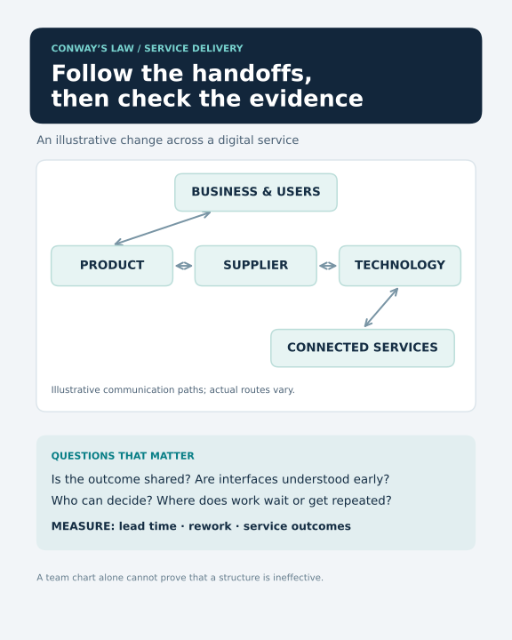

*Draft for review. The example is fictional and does not describe a particular organisation.*

# When Team Boundaries Shape Delivery: A Practical Conway’s Law Check

A delivery structure can feel normal simply because everyone has learned to work within it. That does not tell us whether it is effective—or ineffective.

Conway’s Law gives us a useful lens: the way people communicate can influence the design of the systems they produce. I find the practical leadership question is: **do our communication paths support the end-to-end service we are trying to deliver?**

## A fictional change

Imagine a digital service involving business representatives, a product team, technology specialists, a supplier and several connected services. Each has a legitimate role.

The product team clarifies the business need. The supplier develops a change. Technology specialists coordinate interfaces and environments. A downstream team owns a component that needs data from the new solution.

That structure can work. It becomes risky when an important interface requirement is discovered only after design and development have progressed.

For example, a downstream service may require an additional field or a different data format. The team may need to revisit the design, change the integration and repeat tests. There may be many reasons: a late business decision, an evolving requirement, an unavailable specialist or a genuine communication gap.

Conway’s Law helps us form questions. It does not establish the cause of a specific delay.

## What should a delivery leader examine?

**Shared outcome.** Can every team explain the customer or business outcome? Is one person accountable for ensuring that the end-to-end outcome has an owner?

**Early interfaces.** Are the teams that produce and consume the data involved while requirements and solution options are being shaped?

**Decisions and ownership.** Is it clear who decides priorities, approves business requirements, owns an interface and resolves a conflict?

**Testing and readiness.** Do business acceptance, integration testing and operational readiness cover different risks without gaps? Are test results and decisions visible to the relevant teams?

**Feedback and improvement.** After release, is someone checking whether the change was adopted and produced its intended outcome?

## Measure the work, not the org chart

Select a small sample of recent changes and follow them from the initial need to delivery and use. For each change, look at:

- **End-to-end elapsed time:** From the agreed starting point to a usable release.
- **Waiting time:** Where work waited for information, decisions, environments or another team.
- **Rework:** What had to be changed or retested because an expectation was discovered or changed later.
- **Quality and outcomes:** Relevant defects, production issues, adoption and the customer or business outcome.

These are diagnostic signals. They need context: a high-risk change may legitimately require more review, and a single delayed change does not prove a systemic problem.

## Start with a small experiment

A reorganisation is one possible intervention, but it need not be the first one. A team could test a shared refinement session, an explicit interface checklist and a single visible dependency record for a few changes.

Then compare what happened: were downstream questions raised earlier? Did work wait less? Did testing find fewer unexpected interface gaps? Did customers experience the expected benefit?

A structure is effective when it helps people make timely decisions, manage necessary controls and deliver a reliable outcome. The only way to know is to examine the real work and learn from the evidence.

## Sources

- [Melvin Conway: Conway’s Law](https://melconway.com/Home/Conways_Law.html)
- [DORA: Visibility of work in the value stream](https://dora.dev/capabilities/work-visibility-in-value-stream/)
- [PeopleCert: ITIL and DevOps collaboration](https://itil.com/Itil-News-and-Announcements/itil-devops-collaboration)

*Independent learning reflection. ITIL® is a registered trademark of the PeopleCert group.*

